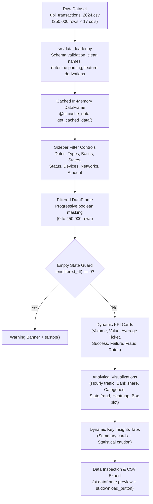
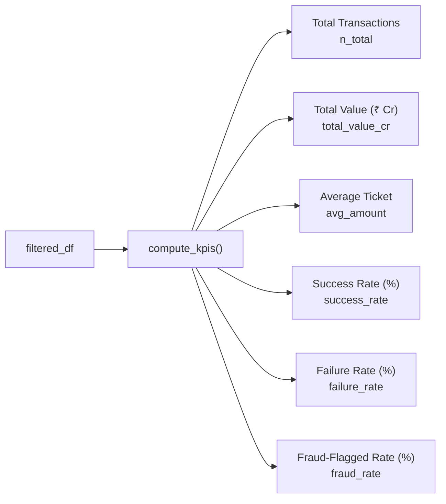
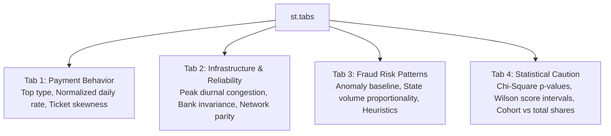
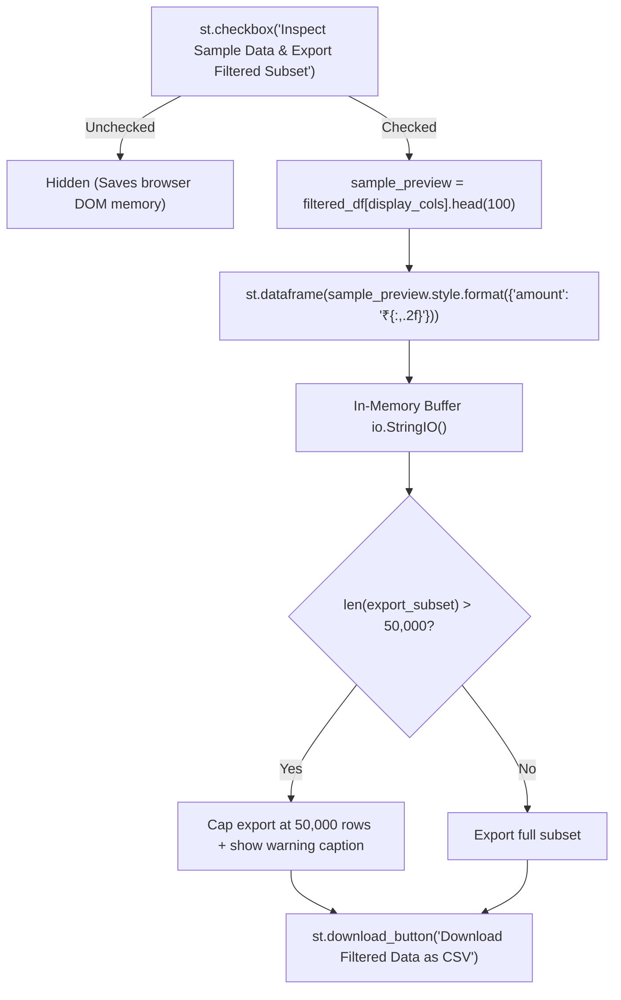

# Comprehensive Code Walkthrough: UPI Transaction Analytics Dashboard

**Project Title:** *UPI Transaction Analytics: Exploring Payment Behavior, Transaction Reliability and Fraud Patterns in India*  
**Authors:** Swaraj Suresh Shinde (PRN: `125B1D053`) & Nikol Dharmraj Ghodke (PRN: `125B1D062`)  
**Target Audience:** First-Year BTech Computer Science Student preparing for Laboratory Viva Examination  
**Primary Source File:** [`app.py`](file:///d:/nikol/collage/devel/project/app.py)  
**Supporting Modules:** [`src/data_loader.py`](file:///d:/nikol/collage/devel/project/src/data_loader.py), [`src/metrics.py`](file:///d:/nikol/collage/devel/project/src/metrics.py), and [`notebooks/mini-project_corrected.ipynb`](file:///d:/nikol/collage/devel/project/notebooks/mini-project_corrected.ipynb)  
**Verification Baseline:** [`outputs/verified_metrics.json`](file:///d:/nikol/collage/devel/project/outputs/verified_metrics.json)

---

## 1. Big Picture

### What the Application Does
The **UPI Transaction Analytics Dashboard** is an interactive web-based data exploration tool. It reads a dataset of **250,000 simulated Indian UPI transactions from the year 2024** and allows users to explore payment behavior, technical failure rates, and fraud indicators through dynamic filters. Users can select date ranges, banks, transaction types, and client devices to observe how key performance indicators (KPIs) and interactive charts adjust in real time.

### End-to-End Data Flow



### How Streamlit Works & Why Caching is Essential
- **Top-to-Bottom Execution:** Unlike traditional desktop software that waits for specific event callbacks, a Streamlit script executes **from line 1 to the final line every single time the user touches a widget** (moving a slider, picking a bank, or clicking a button).
- **The Performance Problem:** The raw CSV file is approximately **29.8 MB** containing **250,000 rows**. If the app parsed this file from disk on every mouse click, every filter change would cause a 2 to 4 second freeze.
- **The Solution (`@st.cache_data`):** Streamlit memorizes (caches) the output of [`load_data()`](file:///d:/nikol/collage/devel/project/src/data_loader.py#L27). After the initial load, subsequent script reruns retrieve the already-cleaned DataFrame instantly from RAM in under 1 millisecond.

---

## 2. Imports and Setup

### Library Inventory & Usage in Code

| Library / Module | Import Statement | Why It Is Needed & Where It Is Used |
| :--- | :--- | :--- |
| `pathlib` | `import pathlib` | Object-oriented filesystem path resolution. Used on lines 5–7 to locate project root and add it to `sys.path`. Also used in `src/data_loader.py` to find the CSV across different operating systems. |
| `sys` | `import sys` | Python runtime environment module. Used on line 7 (`sys.path.insert(0, str(root_dir))`) so Python can find the custom package `src` regardless of the terminal's working directory. |
| `io` | `import io` | In-memory text stream buffer. Used on line 846 (`io.StringIO()`) to serialize filtered data into CSV bytes for download without writing temporary files to disk. |
| `pandas` (`pd`) | `import pandas as pd` | High-performance tabular data structure library. Used throughout `app.py` for DataFrame filtering (`filtered_df[...]`), grouping (`groupby`), crosstabs (`pd.crosstab`), and formatting. |
| `numpy` (`np`) | `import numpy as np` | Numerical computing library. Used on line 475 (`np.stack`) for custom hover arrays and line 617 (`np.round`) for matrix formatting. |
| `plotly.express` (`px`) | `import plotly.express as px` | High-level interactive visualization library. Used on line 640 for the ticket-size box plot (`px.box`) and line 668 for the 2D day/hour heatmap (`px.imshow`). |
| `plotly.graph_objects` (`go`) | `import plotly.graph_objects as go` | Granular, object-oriented plotting library. Used for customized multi-trace charts: hourly bar+line (`go.Bar`, `go.Scatter`), bank market share, and failure heatmap (`go.Heatmap`). |
| `plotly.subplots.make_subplots` | `from plotly.subplots import make_subplots` | Helper to create dual-axis plots (`secondary_y=True`), used in Chart 1 (Hourly) and Chart 4 (State Fraud) to show transaction count on the left y-axis and percentage on the right y-axis. |
| `streamlit` (`st`) | `import streamlit as st` | Web application framework. Provides page configuration, layout containers, metric displays, sidebar controls, markdown rendering, and download widgets. |
| `src.data_loader` | `from src.data_loader import load_data` | Modular helper function in `src/data_loader.py` that reads the CSV, validates column names, parses timestamps, and strips strings. |
| `src.metrics` | `from src.metrics import compute_kpis, compute_hourly_traffic, compute_bank_metrics` | Modular calculations engine in `src/metrics.py` that computes KPI dictionaries, hourly aggregation tables, and bank volume/failure statistics. |

### Page Configuration (`st.set_page_config`)
On lines 24–28 of `app.py`:
```python
st.set_page_config(
    page_title="UPI Analytics Dashboard",
    layout="wide",
    initial_sidebar_state="expanded"
)
```
- `page_title="UPI Analytics Dashboard"`: Sets the browser tab title.
- `layout="wide"`: Expands the dashboard to use the full horizontal monitor width rather than a narrow centered container (essential for displaying 2-column chart grids and 6 KPI cards).
- `initial_sidebar_state="expanded"`: Keeps the left filter panel visible when the page loads so users immediately see available controls.

### Custom Styling (CSS Injection)
Lines 31–82 inject custom CSS rules using `st.markdown(..., unsafe_allow_html=True)`:
- `div[data-testid="stMetric"]`: Targets Streamlit's native metric cards. Gives them a subtle translucent background (`rgba(128, 128, 128, 0.08)`), rounded corners (`border-radius: 10px`), and a gentle hover animation (`transform: translateY(-2px)`). This makes them readable in both Light and Dark Streamlit themes.
- `.dashboard-header`: Adds spacing and a bottom dividing border under the project title.
- `.badge-authors` & `.badge-course`: Pill-shaped metadata tags displaying student names and course details with rounded corners and distinct brand colors.

---

## 3. Data Loading and Cleaning

The data pipeline is split between [`src/data_loader.py`](file:///d:/nikol/collage/devel/project/src/data_loader.py) (the worker) and [`app.py`](file:///d:/nikol/collage/devel/project/app.py#L88) (the cached caller).

### Path Handling with `pathlib`
Hardcoding absolute paths like `C:\Users\admin\Desktop\project\upi.csv` breaks the moment an examiner runs the code on another computer. `src/data_loader.py` uses `pathlib.Path`:
```python
base_dir = pathlib.Path(__file__).resolve().parent.parent
```
- `__file__`: The location of `data_loader.py` inside `src/`.
- `.resolve().parent.parent`: Traverses two directories up to the project root.
- The function checks `base_dir / "data" / preferred_filename`, then `base_dir / preferred_filename`. This works seamlessly across Windows (`\`), macOS (`/`), and Linux (`/`).

### Caching Mechanism (`@st.cache_data`)
On lines 88–93 of `app.py`:
```python
@st.cache_data(show_spinner="Loading and verifying UPI dataset...")
def get_cached_data():
    return load_data()
```
- **What is cached?** The return tuple `(df, load_error)` is stored in Streamlit's in-memory cache.
- **Why?** Preprocessing 250,000 records takes ~1.5 seconds. With caching, this runs exactly once when the server starts.
- **When does the cache refresh?** Streamlit recalculates the function only if the source code of `get_cached_data` changes, or if cache is manually cleared via the developer menu.

### Defensive Preprocessing in `load_data()`
1. **Schema Verification:**
   Checks for 17 mandatory columns (`transaction id`, `timestamp`, `transaction type`, `merchant_category`, `amount (INR)`, `transaction_status`, etc.). If any column is missing, it returns `(None, "Dataset schema error: missing required columns...")` instead of crashing with a `KeyError`.
2. **Column Name Normalization:**
   Renames awkward columns containing spaces and units to clean Python identifiers:
   - `'transaction id'` $\rightarrow$ `'transaction_id'`
   - `'transaction type'` $\rightarrow$ `'transaction_type'`
   - `'amount (INR)'` $\rightarrow$ `'amount'`
3. **Type Coercion:**
   - `pd.to_numeric(df["amount"], errors="coerce").fillna(0)`: Converts non-numeric values to `NaN` and fills them with 0.
   - `pd.to_numeric(df["fraud_flag"], errors="coerce").fillna(0).astype(int)`: Guarantees integer representation (`0` or `1`).
4. **Timestamp Parsing:**
   `df["parsed_timestamp"] = pd.to_datetime(df["timestamp"], errors="coerce")` converts text dates into actual datetime objects. If any row fails to parse (`errors="coerce"` turns it into `NaT`), `df.dropna(subset=["parsed_timestamp"])` removes the corrupt row. (In our verified 250,000 dataset, zero rows fail).
5. **Derived Feature Extraction:**
   - `df["date"]`: Date object (`dt.date`) for discrete date range filtering.
   - `df["hour"]`: Integer (0 to 23) for hourly diurnal volume analysis.
   - `df["month_name"]`: String (`"January"` to `"December"`).
   - `df["month_num"]`: Integer (1 to 12).
   - `df["day_name"]`: String (`"Monday"` to `"Sunday"`).
   - `df["is_weekend_calc"]`: Binary integer (`1` if day of week is Saturday [5] or Sunday [6], else `0`).
6. **Whitespace Stripping:**
   Applies `.astype(str).str.strip()` across 10 categorical string columns (`sender_bank`, `device_type`, `network_type`, etc.) to prevent hidden bugs caused by trailing spaces (e.g., `"SBI "` vs `"SBI"`).
7. **Graceful Error Termination (`st.stop`):**
   In `app.py` lines 98–100:
   ```python
   if load_error or df_raw is None:
       st.error(f"**Data Initialization Failure:** {load_error}")
       st.stop()
   ```
   If the CSV is missing, `st.error()` shows a human-readable banner, and `st.stop()` cleanly halts script execution, preventing a cascade of secondary errors.

---

## 4. Sidebar Filters and Filtering Logic

### Interactive Widget Inventory

All filter widgets are declared in `app.py` lines 126–230:

| # | Widget | Streamlit Function | Variable Name | Return Type | Default Value | Session State Key |
| :---: | :--- | :--- | :--- | :--- | :--- | :--- |
| 1 | Date Range | `st.sidebar.date_input` | `date_selection` | `tuple[date, date]` or `tuple[date]` | `(min_date, max_date)` (Full year 2024) | `f_date_range` |
| 2 | Transaction Type | `st.sidebar.multiselect` | `selected_types` | `list[str]` | `None` (Empty list $\rightarrow$ All included) | `f_types` |
| 3 | Merchant Category | `st.sidebar.multiselect` | `selected_categories` | `list[str]` | `None` (All included) | `f_categories` |
| 4 | Sender State | `st.sidebar.multiselect` | `selected_states` | `list[str]` | `None` (All included) | `f_states` |
| 5 | Sender Bank | `st.sidebar.multiselect` | `selected_banks` | `list[str]` | `None` (All included) | `f_banks` |
| 6 | Transaction Status | `st.sidebar.multiselect` | `selected_status` | `list[str]` | `None` (All included) | `f_status` |
| 7 | Device Type | `st.sidebar.multiselect` | `selected_devices` | `list[str]` | `None` (All included) | `f_devices` |
| 8 | Network Type | `st.sidebar.multiselect` | `selected_networks` | `list[str]` | `None` (All included) | `f_networks` |
| 9 | Fraud Indicator | `st.sidebar.selectbox` | `selected_fraud_choice` | `str` | `"All Transactions"` | `f_fraud` |
| 10 | Amount Range | `st.sidebar.slider` | `selected_amount_range` | `tuple[int, int]` | `(10, 42099)` (min to max) | `f_amount_range` |

### How `session_state` and Filter Reset Work
Streamlit's `st.session_state` is a dictionary-like storage that persists values across user clicks.
- Each widget is assigned a unique `key` parameter (`f_types`, `f_banks`, etc.).
- When the user clicks **"Reset All Filters"** (lines 120–122):
  ```python
  def reset_all_filters():
      for k in FILTER_KEYS:
          if k in st.session_state:
              del st.session_state[k]

  if st.sidebar.button("Reset All Filters", ...):
      reset_all_filters()
      st.rerun()
  ```
  Deleting the keys from `st.session_state` causes Streamlit to recreate every widget with its default initial values, and `st.rerun()` immediately re-renders the dashboard back to the unconstrained 250,000 dataset.

### The Progressive Boolean-Mask Filtering Engine
In `app.py` lines 235–273, the filtering engine starts with a shallow copy of the entire dataset and progressively applies boolean masks:
```python
filtered_df = df_raw.copy()
```
For each widget, if the user made a selection, `filtered_df` is filtered using pandas `.isin()`:
```python
if selected_types:
    filtered_df = filtered_df[filtered_df["transaction_type"].isin(selected_types)]
if selected_banks:
    filtered_df = filtered_df[filtered_df["sender_bank"].isin(selected_banks)]
if selected_status:
    filtered_df = filtered_df[filtered_df["transaction_status"].isin(selected_status)]
```
Notice: if `selected_banks` is empty (`[]`), the `if selected_banks:` condition evaluates to `False`, meaning **no filter is applied and all banks remain included**.

#### Tiny Worked Example of Filtering
Suppose our dataset has just 4 rows:

| row_id | sender_bank | transaction_status | amount |
| :---: | :--- | :--- | :--- |
| **Row 1** | SBI | SUCCESS | ₹500 |
| **Row 2** | SBI | FAILED | ₹1,200 |
| **Row 3** | HDFC | FAILED | ₹3,000 |
| **Row 4** | ICICI | SUCCESS | ₹150 |

Now, suppose the user selects:
- `selected_banks = ["SBI"]`
- `selected_status = ["FAILED"]`

**Step 1:** Apply Bank Filter:
- `filtered_df["sender_bank"].isin(["SBI"])` evaluates to: `[True, True, False, False]`.
- Rows 3 and 4 are removed. Remaining: **Row 1** and **Row 2**.

**Step 2:** Apply Status Filter on the remaining rows:
- `filtered_df["transaction_status"].isin(["FAILED"])` evaluates to: `[False, True]`.
- Row 1 is removed.

**Final Result:** Only **Row 2** remains. All subsequent KPIs and charts are computed strictly on Row 2.

### Empty State Guard
Lines 336–339 handle the scenario where a combination of filters yields zero matching records (e.g., amount > ₹40,000 and status = FAILED on 3G network):
```python
if len(filtered_df) == 0:
    st.warning("**No transactions match the selected filter criteria.** Please widen or reset your sidebar filters to inspect data.")
    st.info("Tip: Click **'Reset All Filters'** in the sidebar to restore the complete 250,000 transaction dataset.")
    st.stop()
```
**Why this is crucial:** If `filtered_df` has 0 rows and the script continued executing, lines like `hourly_df.iloc[0]` or `.value_counts().index[0]` would throw an `IndexError: single positional indexer is out-of-bounds` and crash the dashboard with a red error screen. `st.stop()` halts execution gracefully and guides the user.

---

## 5. KPI Cards

The 6 top-level KPI cards are calculated dynamically by `src/metrics.py:compute_kpis(filtered_df)` and displayed across 6 columns in `app.py` lines 345–409.



### Exact Formulas and Variable Names

| KPI Card | Exact Variable in Code | Mathematical Formula | Verified Benchmark Value (Full Dataset) |
| :--- | :--- | :--- | :--- |
| **Total Transactions** | `n_total` | `len(df)` | **250,000** |
| **Total Value** | `total_value` & `total_value_cr` | `df["amount"].sum()`<br>`total_value_cr = total_value / 10_000_000.0` | **₹32.79 Cr** (`₹327,939,009`) |
| **Average Ticket** | `avg_amount` | `df["amount"].mean()` | **₹1,311.76** |
| **Success Rate** | `success_rate` | `(n_success / n_total) * 100.0`<br>where `n_success = (df["transaction_status"] == "SUCCESS").sum()` | **95.05%** (`237,624` transactions) |
| **Failure Rate** | `failure_rate` | `(n_failed / n_total) * 100.0`<br>where `n_failed = (df["transaction_status"] == "FAILED").sum()` | **4.95%** (`12,376` transactions) |
| **Fraud-Flagged Rate** | `fraud_rate` | `(n_fraud / n_total) * 100.0`<br>where `n_fraud = (df["fraud_flag"] == 1).sum()` | **0.192%** (`480` transactions) |

### Why Failure Rate Uses the SAME Filtered Data
Notice the calculation:
$$\text{Failure Rate} = \frac{\text{n\_failed}}{\text{n\_total}} \times 100$$
Both `n_failed` and `n_total` are counted from the **exact same `filtered_df`**.
- If the user filters for **SBI only**, `n_total = 62,693` and `n_failed = 3,095`.
- $\text{Failure Rate} = (3,095 / 62,693) \times 100 = \mathbf{4.94\%}$.
- This gives the **true cohort failure rate** of SBI, rather than dividing by the global 250,000 total.

### Guarding Against Division by Zero
In `src/metrics.py` lines 11–17:
```python
n_total = len(df)
if n_total == 0:
    return {
        "n_total": 0, "total_value": 0.0, "total_value_cr": 0.0,
        "avg_amount": 0.0, "n_success": 0, "success_rate": 0.0,
        "n_failed": 0, "failure_rate": 0.0, "n_fraud": 0, "fraud_rate": 0.0
    }
```
If an empty slice reaches `compute_kpis`, the function immediately returns safely without attempting `(n_succ / 0) * 100`, which would otherwise raise a `ZeroDivisionError`.

### "Fraud-Flagged" vs. "Confirmed Fraud"
The dashboard specifically uses the label **"Fraud-Flagged Rate"** rather than "Confirmed Fraud":
- In real banking, a **fraud flag** is an algorithmic heuristic or automated security rule (e.g., transaction during odd hours or from a new device). Many flags turn out to be false alarms.
- **Confirmed fraud** refers to legally adjudicated fraud with financial chargebacks.
- Because this dataset is simulated and has only a binary indicator (`fraud_flag` $\in \{0, 1\}$), calling it "Fraud-Flagged" prevents misleading executives or examiners into thinking that 480 verified financial crimes occurred.

---

## 6. Analytical Visualizations (All Charts)

The dashboard presents **6 core analytical charts** arranged in a 2-column grid, plus **1 bonus expandable view**.

```
+------------------------------------+------------------------------------+
|  Chart 1: Hourly Traffic Velocity  |  Chart 2: Bank Ecosystem Share     |
|  vs. Failure Rate (Dual-Axis)      |  vs. Failure Reliability (Dual-Y)  |
+------------------------------------+------------------------------------+
|  Chart 3: Merchant Category        |  Chart 4: State-Level Fraud Volume |
|  Transaction Volume (Horiz Bar)    |  & Occurrence Rate (Dual-Axis)     |
+------------------------------------+------------------------------------+
|  Chart 5: Failure Rate Heatmap:    |  Chart 6: Amount Distribution      |
|  Network Type × Device Type        |  by Type (Box Plot, Log Scale)     |
+------------------------------------+------------------------------------+
|  Optional View (Expander): Day-of-Week × Hourly Intensity Heatmap       |
+------------------------------------+------------------------------------+
```

---

### Chart 1: Hourly Traffic Velocity vs. Failure Rate
- **Question Answered:** At what hours of the day does network traffic peak, and do high-traffic rush hours cause transaction failure rates to spike?
- **Data Transformation (`src/metrics.py:compute_hourly_traffic`):**
  Groups `filtered_df` by `hour` (0 to 23), counting total transactions and summing failed transactions:
  ```python
  hourly = df.groupby("hour").agg(
      volume=("transaction_id", "count"),
      failed=("transaction_status", lambda s: (s == "FAILED").sum())
  ).reset_index()
  hourly["failure_rate"] = (hourly["failed"] / hourly["volume"] * 100.0).fillna(0)
  ```
  *Small Example Transformation:*
  
  *Input:*
  | hour | transaction_id | transaction_status |
  | :---: | :---: | :---: |
  | 18 | TXN01 | SUCCESS |
  | 18 | TXN02 | FAILED |
  | 19 | TXN03 | SUCCESS |
  
  *Output:*
  | hour | volume | failed | failure_rate |
  | :---: | :---: | :---: | :---: |
  | 18 | 2 | 1 | 50.0% |
  | 19 | 1 | 0 | 0.0% |

- **Plotly Functions & Chart Type:**
  `make_subplots(specs=[[{"secondary_y": True}]])`: Combines a **Bar chart** (`go.Bar`) on the left y-axis with a **Scatter line chart** (`go.Scatter`, `mode="lines+markers"`) on the right y-axis.
- **Key Parameters:**
  - `secondary_y=False`: Volume bars in blue (`#3b82f6`, opacity 0.75).
  - `secondary_y=True`: Failure rate line in vivid red (`#ef4444`, width 3).
  - `dtick=2`: Shows x-axis ticks at 2-hour increments (0, 2, 4, ... 22).
  - `range=[0, max(8, failure_rate.max() + 2)]`: Right y-axis scale is pinned around 0–8% so minor 0.1% ripples don't look like dramatic swings.
- **What It Reveals:** Traffic accelerates through the evening, peaking at **19:00 (21,232 transactions)** and **18:00 (20,064 transactions)**.
- **Analytical Caution:** The failure rate line remains almost completely flat across all 24 hours (between **4.71% and 5.17%**). High volume does **not** degrade UPI reliability.

---

### Chart 2: Bank Ecosystem: Market Share vs. Failure Reliability
- **Question Answered:** Which banks handle the largest share of UPI transactions, and are larger banks more or less prone to technical failures than smaller banks?
- **Data Transformation (`src/metrics.py:compute_bank_metrics`):**
  Groups `filtered_df` by `sender_bank`, computing total transactions, failed transactions, and rupee volume:
  ```python
  bank_df = df.groupby("sender_bank").agg(
      total_tx=("transaction_id", "count"),
      failed_tx=("transaction_status", lambda s: (s == "FAILED").sum()),
      total_amt=("amount", "sum")
  ).reset_index()
  bank_df["market_share_pct"] = (bank_df["total_tx"] / total_records * 100.0)
  bank_df["failure_rate_pct"] = (bank_df["failed_tx"] / bank_df["total_tx"] * 100.0).fillna(0)
  ```
- **Plotly Functions & Chart Type:**
  Dual-axis figure using `go.Figure()` with `yaxis="y"` for blue bars (`go.Bar`) and `yaxis="y2"` for red dotted line (`go.Scatter`, `dash="dot"`).
- **Key Parameters:**
  - `customdata=np.stack((bank_df["total_tx"], bank_df["value_cr"]), axis=-1)`: Passes extra data into the hover tooltip so hovering over a bank shows its raw count and Crore value.
- **What It Reveals:** State Bank of India (SBI) is the market giant, processing **62,693 transactions (25.08% market share)**, followed by HDFC (**37,485, 14.99%**).
- **Analytical Caution:** While Yes Bank has the nominally highest failure rate (**5.10%**) and HDFC the lowest (**4.82%**), this tiny 0.28% gap is statistically insignificant (Chi-Square test $p = 0.863$). Never claim one bank is "failing" without checking statistical significance!

---

### Chart 3: Merchant Category Transaction Volume
- **Question Answered:** In which commercial categories do users spend the most frequency of transactions?
- **Data Transformation (`app.py` lines 509–515):**
  ```python
  cat_df = filtered_df.groupby("merchant_category").agg(
      volume=("transaction_id", "count"),
      total_value=("amount", "sum")
  ).reset_index()
  cat_df = cat_df.sort_values(by="volume", ascending=True)
  ```
- **Plotly Functions & Chart Type:**
  Horizontal Bar chart (`go.Bar(orientation="h")`).
  - **Why Horizontal?** Category names like `Supermarket`, `Food & Beverage`, `Transportation`, and `Entertainment` are long. Horizontal bars allow the labels on the y-axis to be read easily without ugly angled text.
- **Key Parameters:**
  - `y=cat_df["merchant_category"]`, `x=cat_df["volume"]`.
  - Indigo color `#6366f1`.
  - Sorted `ascending=True` so the highest-volume category appears at the top.
- **What It Reveals:** Daily essentials dominate UPI usage, with **Grocery**, **Food & Beverage**, and **Retail** capturing the highest transaction counts.
- **Analytical Caution:** A category with high transaction count does not necessarily have the highest financial value (e.g., thousands of ₹30 tea purchases vs. fewer ₹15,000 electronics purchases).

---

### Chart 4: State-Level Fraud-Flagged Volume & Occurrence Rate
- **Question Answered:** Which Indian states have the highest number of flagged fraud transactions, and do those states also have a higher rate of fraud per transaction?
- **Data Transformation (`app.py` lines 539–545):**
  ```python
  state_df = filtered_df.groupby("sender_state").agg(
      total_tx=("transaction_id", "count"),
      fraud_tx=("fraud_flag", lambda s: (s == 1).sum())
  ).reset_index()
  state_df["fraud_rate_pct"] = (state_df["fraud_tx"] / state_df["total_tx"] * 100.0).fillna(0)
  state_df = state_df.sort_values(by="fraud_tx", ascending=False)
  ```
- **Plotly Functions & Chart Type:**
  Dual-axis chart (`make_subplots(specs=[[{"secondary_y": True}]])`) combining amber bars (`go.Bar`, `#f59e0b`) on the left with a magenta line (`go.Scatter`, `#be185d`) on the right.
- **Key Parameters:**
  - `tickangle=-30`: Rotates state names on the x-axis by -30 degrees for clean legibility.
  - `yaxis2`: Range set to `[0, max(0.4, state_df["fraud_rate_pct"].max() * 1.3)]` so percentages (around 0.15%–0.25%) are clearly visible.
- **What It Reveals:** Maharashtra has the highest absolute fraud count (**71 transactions**), followed by Karnataka (**69 transactions**).
- **Analytical Caution (The Rate vs. Count Trap):** Maharashtra has the most fraud simply because it has the most people and transactions (**37,422 total transactions**). Its fraud *rate* is **0.190%**, virtually identical to the national average of **0.192%**. It is **not** a high-risk state!

---

### Chart 5: Infrastructure Failure Rate: Network vs. Device
- **Question Answered:** Does transaction failure correlate with a specific technical combination of mobile network (e.g., 3G vs 5G) and client device (Android vs iOS vs Web)?
- **Data Transformation (`app.py` lines 591–600):**
  Uses two 2-dimensional cross-tabulations (`pd.crosstab`):
  ```python
  net_dev_counts = pd.crosstab(filtered_df["network_type"], filtered_df["device_type"])
  net_dev_fails = pd.crosstab(
      filtered_df["network_type"],
      filtered_df["device_type"],
      values=(filtered_df["transaction_status"] == "FAILED").astype(int),
      aggfunc="sum"
  ).fillna(0)
  net_dev_rate = (net_dev_fails / net_dev_counts * 100.0).fillna(0)
  ```
  *Small Example Transformation:*

  *Total Transactions Matrix (`net_dev_counts`):*
  | network_type | Android | iOS | Web |
  | :--- | :---: | :---: | :---: |
  | **4G** | 112,500 | 29,750 | 7,563 |
  | **5G** | 46,950 | 12,480 | 3,152 |

  *Failed Transactions Matrix (`net_dev_fails`):*
  | network_type | Android | iOS | Web |
  | :--- | :---: | :---: | :---: |
  | **4G** | 5,558 | 1,467 | 439 |
  | **5G** | 2,282 | 617 | 140 |

  *Failure Rate (%) Matrix (`net_dev_rate`):*
  | network_type | Android | iOS | Web |
  | :--- | :---: | :---: | :---: |
  | **4G** | 4.94% | 4.93% | 5.80% |
  | **5G** | 4.86% | 4.94% | 4.44% |

- **Plotly Functions & Chart Type:**
  Interactive annotated Heatmap (`go.Heatmap`).
- **Key Parameters:**
  - `colorscale="Reds"`, with `zmin=4.0` and `zmax=6.0` to highlight the narrow variation band.
  - `texttemplate="%{text:.2f}%"`: Directly stamps each cell with its percentage.
  - `hovertext=custom_hover`: Custom string matrix showing Network, Device, Total Tx, Failed Tx, and Rate for each cell.
- **What It Reveals:** All cells hover within a narrow band of **4.44% to 5.80%**.
- **Analytical Caution:** Cells with smaller sample sizes (like Web on 3G, with only ~600 transactions) show slightly more variance, but there is no systemic infrastructural breakdown.

---

### Chart 6: Ticket Size Distribution by Transaction Type
- **Question Answered:** How does transaction amount vary between Peer-to-Peer (`P2P`), Merchant (`P2M`), `Bill Payment`, and `Recharge`?
- **Data Transformation:**
  Direct plotting of raw values using `px.box(filtered_df, x="transaction_type", y="amount", log_y=True)`.
- **Plotly Functions & Chart Type:**
  Box Plot (`px.box`).
  - **Why a Box Plot?** It summarizes the 5-number distribution: Minimum, 25th percentile (Q1), Median (Q2), 75th percentile (Q3), and Maximum, plus outlier dots.
- **Key Parameters:**
  - `log_y=True`: **Logarithmic scale on the vertical axis.**
  - **Why Log Scale?** Amounts range from ₹10 all the way to ₹42,099. On a standard linear axis, 75% of data points (under ₹1,000) would be squashed into a microscopic flat line at the bottom. A log scale allows both ₹50 tea payments and ₹40,000 bank transfers to be viewed clearly.
  - `color_discrete_sequence=px.colors.qualitative.Safe`: Color palette designed for visual clarity.
- **What It Reveals:** The median ticket size is remarkably similar across types (~₹629), but high outliers extend past ₹40,000 in `P2P` and `Bill Payment`.
- **Analytical Caution:** Because the y-axis is logarithmic, the visual distance between ₹10 and ₹100 is identical to the distance between ₹1,000 and ₹10,000. Remind the examiner that equal visual spacing does not mean equal rupee differences!

---

### Optional Bonus Chart: Day-of-Week × Hourly Intensity Heatmap
- **Location:** Placed inside `st.expander("Optional View: Day-of-Week × Hourly Traffic Intensity Matrix")` on line 660.
- **Data Transformation:**
  ```python
  day_hour_counts = pd.crosstab(filtered_df["day_name"], filtered_df["hour"])
  days_order = ["Monday", "Tuesday", "Wednesday", "Thursday", "Friday", "Saturday", "Sunday"]
  day_hour_counts = day_hour_counts.reindex([d for d in days_order if d in day_hour_counts.index])
  ```
- **Plotly Function:** `px.imshow(day_hour_counts, color_continuous_scale="Viridis", aspect="auto")`.
- **What It Reveals:** Shows an activity heat matrix across all $7 \times 24 = 168$ hours in a week. Confirms that rush hours (17:00–21:00) occur uniformly on both weekdays and weekends.

---

## 7. Dynamic Key Insights Section

The insights section (lines 687–820) organizes conclusions into **4 interactive tabs** using `st.tabs`:
1. `Payment Behavior`
2. `Infrastructure & Reliability`
3. `Fraud Risk Patterns`
4. `Methodological & Statistical Caution`



### Dynamic Code Derivations
Rather than printing static pre-written text, all insight cards use Python calculations on `filtered_df`:
- **Most Prevalent Type:**
  `top_type = filtered_df["transaction_type"].value_counts().index[0]`
  `top_type_pct = (top_type_count / n_total * 100)`
- **Weekday vs. Weekend Normalized Velocity:**
  ```python
  wkday_tx = int((filtered_df["is_weekend_calc"] == 0).sum())
  wkend_tx = int((filtered_df["is_weekend_calc"] == 1).sum())
  wkday_avg_daily = wkday_tx / 5.0
  wkend_avg_daily = wkend_tx / 2.0
  ```
  Raw numbers show weekdays have 178,663 transactions and weekends have 71,337. But a week has 5 weekdays and only 2 weekend days! Dividing by 5 and 2 yields:
  - Weekday rate: **35,732.6 tx/day**
  - Weekend rate: **35,668.5 tx/day**
  - **Key finding:** Normalized daily UPI velocity is virtually identical (difference < 0.18%). UPI does not take weekends off.
- **Mean vs. Median Ticket Skew:**
  `median_amt = filtered_df["amount"].median()` (**₹629**)  
  `avg_amount = filtered_df["amount"].mean()` (**₹1,311.76**)  
  Because the mean is more than double the median, this proves positive skewness caused by heavy micro-transactions under ₹1,000 mixed with a small tail (8.47%) of large transfers (> ₹3,558).

### Why Wording Stays Conditional on Data
All card texts are formatted using Python f-strings:
```python
st.markdown(
    f"The most prevalent transaction type in the current selection is **{top_type}** with "
    f"**{top_type_count:,} transactions** (**{top_type_pct:.2f}%** of total traffic)."
)
```
If an examiner filters for `Merchant Category = Food & Beverage`, the text automatically changes to reflect Food & Beverage metrics without code alterations.

### The Purpose of Statistical Caution Notes (Tab 4)
Examiners love testing whether students understand the difference between random noise and true statistical significance. Tab 4 documents:
1. **Chi-Square Tests of Independence:**
   - Bank vs. Failure Status: $\chi^2 = 3.235, p = 0.863$ (Cramer's $V = 0.0036$).
   - Device vs. Failure Status: $\chi^2 = 1.181, p = 0.554$ (Cramer's $V = 0.0022$).
   - Network vs. Failure Status: $\chi^2 = 3.853, p = 0.278$ (Cramer's $V = 0.0039$).
   - **Conclusion:** Because all $p$-values are far greater than $0.05$, differences between banks or devices are pure stochastic noise.
2. **Extreme Imbalance & Confidence Intervals:**
   - Only 480 fraud flags exist across 250,000 transactions (0.192%).
   - When divided across 10 states, each state only has between 35 and 71 positive flags.
   - The 95% Wilson score confidence interval for Karnataka (69/29,756 = 0.232%) is `[0.182%, 0.294%]`, which completely overlaps with Tamil Nadu (40/25,367 = 0.158%, `[0.115%, 0.215%]`). They are statistically indistinguishable.
3. **Cohort Share vs. Cohort Rate:**
   Android represents **74.97% of all system failures** (9,278 / 12,376). This sounds alarming until you realize Android represents **75.11% of all transactions**! Within Android, the failure rate is **4.94%**, identical to iOS (**4.93%**).

---

## 8. Table and CSV Download

At the bottom of `app.py` (lines 827–861), the dashboard provides interactive inspection and data export.



### Code Implementation
```python
show_table = st.checkbox("Inspect Sample Data & Export Filtered Subset", value=False)

if show_table:
    display_cols = [
        "transaction_id", "timestamp", "transaction_type", "merchant_category",
        "amount", "transaction_status", "sender_bank", "receiver_bank",
        "sender_state", "device_type", "network_type", "fraud_flag"
    ]
    sample_preview = filtered_df[display_cols].head(100).copy()
    
    st.dataframe(
        sample_preview.style.format({"amount": "₹{:,.2f}"}),
        width="stretch",
        height=320
    )
```

### How the CSV Download Button Works
```python
    csv_buffer = io.StringIO()
    export_subset = filtered_df[display_cols]
    if len(export_subset) > 50000:
        st.caption("Note: Download is capped at 50,000 rows for browser performance.")
        export_subset = export_subset.head(50000)
        
    export_subset.to_csv(csv_buffer, index=False)
    csv_bytes = csv_buffer.getvalue().encode("utf-8")
    
    st.download_button(
        label=f"Download Filtered Data as CSV ({len(export_subset):,} rows)",
        data=csv_bytes,
        file_name="filtered_upi_transactions.csv",
        mime="text/csv"
    )
```
1. `io.StringIO()` creates an in-memory virtual text file.
2. `export_subset.to_csv(csv_buffer, index=False)` writes the CSV text into RAM without writing to the user's hard drive.
3. `.getvalue().encode("utf-8")` converts the text into raw bytes suitable for browser download.
4. **Safety Cap (50,000 rows):** If a user tries to download all 250,000 rows, serializing and downloading a 30 MB file inside a browser tab can trigger browser memory thrashing or UI freezing. Capping at 50,000 rows protects performance while giving more than enough data for Excel analysis.

---

## 9. Machine Learning Experiment (From the Project Notebook)

> [!NOTE]
> **Examiner Note:** The machine learning classification pipeline is an **offline academic experiment** documented in [`notebooks/mini-project_corrected.ipynb`](file:///d:/nikol/collage/devel/project/notebooks/mini-project_corrected.ipynb) and [`docs/code_walkthrough.md`](file:///d:/nikol/collage/devel/project/docs/code_walkthrough.md). It is **not** part of the live dashboard `app.py`. The dashboard focuses on interactive descriptive analytics.

### Feature Encoding Strategy (`pd.get_dummies`)
In the notebook, the authors set up a classification experiment to test whether technical transaction failure (`transaction_status == "FAILED"`) can be predicted from transaction attributes.

```python
feature_cols = [
    'transaction type', 'merchant_category', 'amount (INR)',
    'sender_age_group', 'receiver_age_group', 'sender_state',
    'sender_bank', 'receiver_bank', 'device_type',
    'network_type', 'hour_of_day', 'day_of_week', 'is_weekend'
]

X = pd.get_dummies(df[feature_cols], drop_first=True)
```

1. **Why `transaction id` MUST Be Excluded:**
   `transaction id` has 250,000 unique values (`TXN0000000001` to `TXN0000250000`). If one-hot encoded, it would create 250,000 columns. This would instantly crash the computer with an `OutOfMemoryError`. Furthermore, primary keys carry zero generalizable predictive pattern (data leakage/memorization).
2. **Why `drop_first=True` is Used:**
   Converting categorical variables with $k$ categories into dummy variables introduces multicollinearity (the **dummy variable trap**), because the $k$-th column is completely redundant:
   $$x_k = 1 - \sum_{i=1}^{k-1} x_i$$
   Setting `drop_first=True` drops the baseline reference category, yielding $k - 1$ columns per feature and exactly **57 numeric features** across the dataset.

### Stratified Train/Test Split
```python
X_train, X_test, y_train, y_test = train_test_split(
    X, y, test_size=0.2, random_state=42, stratify=y
)
```
- The dataset has an imbalanced class distribution: **95.05% SUCCESS (0)** and **4.95% FAILED (1)**.
- `stratify=y` ensures that both the training set (200,000 rows) and the test set (50,000 rows) have the exact same 4.95% failure proportion (2,475 failed rows in the test set). Without stratification, a random split could randomly sample fewer failures into the test set.

### Baseline vs. Balanced Logistic Regression

#### 1. Baseline Model (`LogisticRegression(max_iter=1000)`)
- **Reported Accuracy:** `95.05%`
- **Confusion Matrix:**
  $$\begin{bmatrix} \text{Actual FAILED} \\ \text{Actual SUCCESS} \end{bmatrix} \rightarrow \begin{bmatrix} 0 & 2,475 \\ 0 & 47,525 \end{bmatrix}$$
- **Recall for FAILED Class:** `0.00%` (Precision: `0.00`, F1: `0.00`).
- **Why 95.05% Accuracy is Misleading (The Accuracy Paradox):**
  The model predicted `SUCCESS` for every single transaction! Because 95.05% of transactions are successful, a "dummy model" that always predicts SUCCESS automatically gets 95.05% accuracy while failing to detect even a single failure. Overall accuracy is a useless metric under class imbalance.

#### 2. Balanced Model (`class_weight="balanced"`)
To prevent the model from ignoring the minority class, scikit-learn weights errors inversely proportional to class frequency:
$$w_{\text{SUCCESS}} \approx 0.526, \quad w_{\text{FAILED}} \approx 10.10$$
- **New Metrics:**
  - Accuracy: `52.06%`
  - Recall for FAILED: `48.81%` (1,208 / 2,475 detected)
  - Precision for FAILED: `5.05%`
- **The Critical Viva Insight:**
  Did the model really learn to predict failures? **No.**
  Because transaction failures in this dataset are random technical glitches (as proven by Chi-Square $p > 0.27$), there is **zero true predictive signal in the metadata**. The balanced class weights simply forced the model to predict `FAILED` roughly 50% of the time. When you guess at random 50% of the time on a dataset with a 4.95% failure rate, your recall will be ~50%, and your precision will match the baseline rate of ~5%. The model acts like a random coin toss!

---

## 10. Line-by-Line Annotated Listing of `app.py`

This section reproduces the entire code of [`app.py`](file:///d:/nikol/collage/devel/project/app.py) (all 864 lines) in contiguous blocks of 15 to 35 lines, with detailed explanations.

---

### Block 1: Lines 1–20 — Imports & Environment Path Configuration

```python
1: import pathlib
2: import sys
3: 
4: # Ensure project root is in sys.path for robust modular imports
5: root_dir = pathlib.Path(__file__).resolve().parent
6: if str(root_dir) not in sys.path:
7:     sys.path.insert(0, str(root_dir))
8: 
9: import io
10: import pandas as pd
11: import numpy as np
12: import plotly.express as px
13: import plotly.graph_objects as go
14: from plotly.subplots import make_subplots
15: import streamlit as st
16: 
17: # Modular helper imports
18: from src.data_loader import load_data
19: from src.metrics import compute_kpis, compute_hourly_traffic, compute_bank_metrics
20: 
```

- **What this does:**
  Resolves the folder containing `app.py` using `pathlib` and inserts it at index 0 of Python's search path (`sys.path`). It then imports the required data science libraries and project helper functions from `src/`.
- **Why it is written this way:**
  If a user launches Streamlit from inside `src/` or an outside parent directory, Python might throw `ModuleNotFoundError: No module named 'src'`. Inserting `root_dir` into `sys.path` guarantees the project works regardless of where the terminal command was executed.
- **Examiner might ask:**
  *"Why did you put your functions in `src/` instead of writing everything inside `app.py`?"*  
  **Answer:** Separation of concerns and code modularity. It allows unit testing and notebook reusability without duplicating data-cleaning logic.

---

### Block 2: Lines 21–55 — Page Configuration & Metric Card CSS

```python
21: # ==============================================================================
22: # 1. PAGE CONFIGURATION & THEME STYLING
23: # ==============================================================================
24: st.set_page_config(
25:     page_title="UPI Analytics Dashboard",
26:     layout="wide",
27:     initial_sidebar_state="expanded"
28: )
29: 
30: # Custom CSS for polished college mini-project UI
31: st.markdown("""
32: <style>
33:     /* Metric Card Styling - Theme Adaptive (Translucent for both Dark & Light themes) */
34:     div[data-testid="stMetric"] {
35:         background-color: rgba(128, 128, 128, 0.08);
36:         border: 1px solid rgba(128, 128, 128, 0.2);
37:         padding: 14px 18px;
38:         border-radius: 10px;
39:         box-shadow: 0 1px 3px rgba(0,0,0,0.05);
40:         transition: transform 0.15s ease, box-shadow 0.15s ease;
41:     }
42:     div[data-testid="stMetric"]:hover {
43:         transform: translateY(-2px);
44:         box-shadow: 0 4px 6px rgba(0,0,0,0.08);
45:     }
46:     div[data-testid="stMetricLabel"] > div {
47:         font-size: 0.85rem !important;
48:         font-weight: 600 !important;
49:         text-transform: uppercase;
50:         letter-spacing: 0.05em;
51:     }
52:     div[data-testid="stMetricValue"] > div {
53:         font-size: 1.6rem !important;
54:         font-weight: 700 !important;
55:     }
```

- **What this does:**
  Initializes the browser window with a wide layout and expanded sidebar, then injects custom CSS targeting `div[data-testid="stMetric"]` to give KPI cards rounded borders, translucent gray background, and hover elevation.
- **Why it is written this way:**
  Streamlit's default metric cards have no background borders and can look plain. Using `rgba(128, 128, 128, 0.08)` ensures cards look sleek in both dark mode and light mode without hardcoding white or black.
- **Examiner might ask:**
  *"What happens if `st.set_page_config` is called after `st.write` or `st.markdown`?"*  
  **Answer:** Streamlit will raise a `StreamlitAPIException`. `st.set_page_config` must be the very first Streamlit command executed in the script.

---

### Block 3: Lines 56–84 — Header & Badge CSS Styling

```python
56:     /* Banner & Subtext */
57:     .dashboard-header {
58:         margin-bottom: 1.2rem;
59:         padding-bottom: 0.8rem;
60:         border-bottom: 2px solid rgba(128, 128, 128, 0.2);
61:     }
62:     .badge-authors {
63:         display: inline-block;
64:         background: rgba(3, 105, 161, 0.15);
65:         color: #0284c7;
66:         padding: 3px 10px;
67:         border-radius: 6px;
68:         font-size: 0.82rem;
69:         font-weight: 600;
70:         margin-right: 8px;
71:     }
72:     .badge-course {
73:         display: inline-block;
74:         background: rgba(100, 116, 139, 0.15);
75:         color: var(--text-color, #64748b);
76:         padding: 3px 10px;
77:         border-radius: 6px;
78:         font-size: 0.82rem;
79:         font-weight: 600;
80:     }
81: </style>
82: """, unsafe_allow_html=True)
83: 
84: 
```

- **What this does:**
  Defines CSS classes `.dashboard-header`, `.badge-authors`, and `.badge-course` and injects them with `unsafe_allow_html=True`.
- **Why it is written this way:**
  Allows rendering university project author tags with modern badge pills. `unsafe_allow_html=True` is required because Streamlit escapes raw HTML strings by default for security.
- **Examiner might ask:**
  *"Why is `unsafe_allow_html=True` considered potentially unsafe in production web apps?"*  
  **Answer:** If user-generated input is passed into it without sanitization, it can introduce Cross-Site Scripting (XSS) vulnerabilities. Here, it is safe because we only inject our own static CSS string.

---

### Block 4: Lines 85–102 — Cached Data Loading & Error Guard

```python
85: # ==============================================================================
86: # 2. CACHED DATA LOADING & DEFENSIVE PREPROCESSING
87: # ==============================================================================
88: @st.cache_data(show_spinner="Loading and verifying UPI dataset...")
89: def get_cached_data():
90:     """
91:     Cached wrapper around src.data_loader.load_data().
92:     """
93:     return load_data()
94: 
95: # Load data
96: df_raw, load_error = get_cached_data()
97: 
98: if load_error or df_raw is None:
99:     st.error(f"**Data Initialization Failure:** {load_error}")
100:     st.stop()
101: 
102: 
```

- **What this does:**
  Decorates `get_cached_data()` with `@st.cache_data`. Calls `load_data()` to unpack `df_raw` and `load_error`. If an error occurred or `df_raw` is `None`, it displays an error box and halts execution via `st.stop()`.
- **Why it is written this way:**
  Prevents re-reading the 30MB CSV file on every user filter change. Defensive error checking with `st.stop()` prevents ugly tracebacks if the dataset file was moved or deleted.
- **Examiner might ask:**
  *"What does `st.stop()` do under the hood?"*  
  **Answer:** It raises a special internal exception (`ScriptControlException`) that terminates script execution immediately at that point without crashing the Streamlit web server.

---

### Block 5: Lines 103–125 — Sidebar Setup & Reset Button

```python
103: # ==============================================================================
104: # 3. SIDEBAR FILTERS WITH SESSION STATE RESET
105: # ==============================================================================
106: st.sidebar.title("Dashboard Filters")
107: st.sidebar.caption("Filter transactions dynamically across all KPIs & charts.")
108: 
109: # Filter key definitions for session state tracking
110: FILTER_KEYS = [
111:     "f_date_range", "f_types", "f_categories", "f_states", "f_banks",
112:     "f_status", "f_devices", "f_networks", "f_fraud", "f_amount_range"
113: ]
114: 
115: def reset_all_filters():
116:     for k in FILTER_KEYS:
117:         if k in st.session_state:
118:             del st.session_state[k]
119: 
120: if st.sidebar.button("Reset All Filters", width="stretch", help="Clear all selections and reset dashboard to default view."):
121:     reset_all_filters()
122:     st.rerun()
123: 
124: st.sidebar.markdown("---")
125: 
```

- **What this does:**
  Creates the sidebar heading and a list of 10 keys matching the widget session state names. Provides a full-width "Reset All Filters" button that loops through `FILTER_KEYS`, deletes them from `st.session_state`, and triggers `st.rerun()`.
- **Why it is written this way:**
  In Streamlit, clearing a widget's session state key forces it to revert to its default value on the subsequent rerun.
- **Examiner might ask:**
  *"What is the difference between `st.rerun()` and reloading the browser page?"*  
  **Answer:** `st.rerun()` executes the Python script immediately on the server while maintaining the active WebSocket connection. A browser reload restarts the entire frontend session from scratch.

---

### Block 6: Lines 126–157 — Filters 1 to 3: Date, Transaction Type, Merchant Category

```python
126: # 1. Date Range Filter
127: min_date = df_raw["date"].min()
128: max_date = df_raw["date"].max()
129: 
130: date_selection = st.sidebar.date_input(
131:     "Date Range",
132:     value=(min_date, max_date),
133:     min_value=min_date,
134:     max_value=max_date,
135:     key="f_date_range",
136:     help="Select start and end date for transactions in 2024."
137: )
138: 
139: # 2. Transaction Type Filter
140: all_types = sorted(df_raw["transaction_type"].unique())
141: selected_types = st.sidebar.multiselect(
142:     "Transaction Type",
143:     options=all_types,
144:     default=None,
145:     placeholder="All Types (P2P, P2M, etc.)",
146:     key="f_types"
147: )
148: 
149: # 3. Merchant Category Filter
150: all_categories = sorted(df_raw["merchant_category"].unique())
151: selected_categories = st.sidebar.multiselect(
152:     "Merchant Category",
153:     options=all_categories,
154:     default=None,
155:     placeholder="All Categories",
156:     key="f_categories"
157: )
158: 
```

- **What this does:**
  Extracts minimum and maximum dates (`2024-01-01` to `2024-12-30`) and creates a 2-point calendar picker. Creates multiselect dropdowns for `transaction_type` and `merchant_category`.
- **Why it is written this way:**
  `default=None` leaves the multiselect empty by default, displaying a clean `placeholder="All Types"`. This avoids cluttering the UI with dozens of pre-selected tags while logically treating an empty selection as "include all".
- **Examiner might ask:**
  *"What does `date_input` return when the user has clicked only the start date but not yet the end date?"*  
  **Answer:** It returns a single-element tuple `(start_date,)`. The downstream filtering code must check the length of this tuple to avoid unpack errors.

---

### Block 7: Lines 158–187 — Filters 4 to 6: Sender State, Sender Bank, Transaction Status

```python
159: # 4. Sender State Filter
160: all_states = sorted(df_raw["sender_state"].unique())
161: selected_states = st.sidebar.multiselect(
162:     "Sender State",
163:     options=all_states,
164:     default=None,
165:     placeholder="All States",
166:     key="f_states"
167: )
168: 
169: # 5. Sender Bank Filter
170: all_banks = sorted(df_raw["sender_bank"].unique())
171: selected_banks = st.sidebar.multiselect(
172:     "Sender Bank",
173:     options=all_banks,
174:     default=None,
175:     placeholder="All Banks",
176:     key="f_banks"
177: )
178: 
179: # 6. Transaction Status Filter
180: selected_status = st.sidebar.multiselect(
181:     "Transaction Status",
182:     options=["SUCCESS", "FAILED"],
183:     default=None,
184:     placeholder="All Statuses",
185:     key="f_status"
186: )
187: 
```

- **What this does:**
  Extracts unique states and banks alphabetically using `sorted(...unique())` and builds multiselect widgets for State, Bank, and Status.
- **Why it is written this way:**
  Sorting categories alphabetically (`sorted(...)`) makes it easy for users to find their state or bank in long lists.
- **Examiner might ask:**
  *"Why did you hardcode `options=["SUCCESS", "FAILED"]` instead of using `df_raw["transaction_status"].unique()`?"*  
  **Answer:** UPI status is strictly binary in this dataset; hardcoding guarantees a consistent order (`SUCCESS` first, `FAILED` second) regardless of row ordering.

---

### Block 8: Lines 188–217 — Filters 7 to 9: Device Type, Network Type, Fraud Indicator

```python
188: # 7. Device Type Filter
189: all_devices = sorted(df_raw["device_type"].unique())
190: selected_devices = st.sidebar.multiselect(
191:     "Device Type",
192:     options=all_devices,
193:     default=None,
194:     placeholder="All Devices (Android, iOS, Web)",
195:     key="f_devices"
196: )
197: 
198: # 8. Network Type Filter
199: all_networks = sorted(df_raw["network_type"].unique())
200: selected_networks = st.sidebar.multiselect(
201:     "Network Type",
202:     options=all_networks,
203:     default=None,
204:     placeholder="All Networks (4G, 5G, etc.)",
205:     key="f_networks"
206: )
207: 
208: # 9. Fraud-Flag Indicator Filter
209: fraud_options = ["All Transactions", "Fraud-Flagged Only (1)", "Non-Fraud Only (0)"]
210: selected_fraud_choice = st.sidebar.selectbox(
211:     "Fraud Indicator",
212:     options=fraud_options,
213:     index=0,
214:     key="f_fraud",
215:     help="Note: fraud_flag is an indicator in this simulated dataset, not confirmed chargebacks."
216: )
217: 
```

- **What this does:**
  Provides multiselect controls for Device Type (`Android`, `iOS`, `Web`), Network Type (`3G`, `4G`, `5G`, `WiFi`), and a single-choice `selectbox` for Fraud Indicator.
- **Why it is written this way:**
  A `selectbox` is used for Fraud Indicator because these three choices are mutually exclusive (you want either all, only flagged, or only non-flagged).
- **Examiner might ask:**
  *"What does `index=0` in `st.sidebar.selectbox` mean?"*  
  **Answer:** It specifies that the first item in the list (`"All Transactions"`) is selected by default when the page loads.

---

### Block 9: Lines 218–232 — Filter 10: Amount Range Slider

```python
218: # 10. Amount Range Slider
219: min_amt = int(df_raw["amount"].min())
220: max_amt = int(df_raw["amount"].max())
221: selected_amount_range = st.sidebar.slider(
222:     "Amount Range (₹)",
223:     min_value=min_amt,
224:     max_value=max_amt,
225:     value=(min_amt, max_amt),
226:     step=100,
227:     key="f_amount_range",
228:     help="Filter transactions by INR value."
229: )
230: 
231: 
```

- **What this does:**
  Finds the absolute minimum (`₹10`) and maximum (`₹42,099`) transaction amounts and renders a dual-thumb range slider stepping by ₹100 increments.
- **Why it is written this way:**
  Passing a 2-tuple to `value=(min_amt, max_amt)` configures Streamlit to render a range slider with two movable handles (lower and upper bound).
- **Examiner might ask:**
  *"Why did you cast `int(df_raw["amount"].min())` to `int`?"*  
  **Answer:** Streamlit sliders require python native `int` or `float` types. Passing a NumPy `int64` can sometimes cause serialization warnings in Streamlit.

---

### Block 10: Lines 233–261 — Filtering Engine: Date & Categorical Masks

```python
233: # ==============================================================================
234: # 4. PROGRESSIVE FILTERING ENGINE
235: # ==============================================================================
236: filtered_df = df_raw.copy()
237: 
238: # Date Range Filter application
239: if isinstance(date_selection, (tuple, list)):
240:     if len(date_selection) == 2:
241:         start_d, end_d = date_selection
242:         filtered_df = filtered_df[(filtered_df["date"] >= start_d) & (filtered_df["date"] <= end_d)]
243:     elif len(date_selection) == 1:
244:         start_d = date_selection[0]
245:         filtered_df = filtered_df[filtered_df["date"] == start_d]
246: 
247: # Multiselect filters (empty list means all included)
248: if selected_types:
249:     filtered_df = filtered_df[filtered_df["transaction_type"].isin(selected_types)]
250: if selected_categories:
251:     filtered_df = filtered_df[filtered_df["merchant_category"].isin(selected_categories)]
252: if selected_states:
253:     filtered_df = filtered_df[filtered_df["sender_state"].isin(selected_states)]
254: if selected_banks:
255:     filtered_df = filtered_df[filtered_df["sender_bank"].isin(selected_banks)]
256: if selected_status:
257:     filtered_df = filtered_df[filtered_df["transaction_status"].isin(selected_status)]
258: if selected_devices:
259:     filtered_df = filtered_df[filtered_df["device_type"].isin(selected_devices)]
260: if selected_networks:
261:     filtered_df = filtered_df[filtered_df["network_type"].isin(selected_networks)]
```

- **What this does:**
  Initializes `filtered_df` and applies boolean masks sequentially for Date, Types, Categories, States, Banks, Status, Devices, and Networks.
- **Why it is written this way:**
  Handles both a full range `len == 2` and a single-day selection `len == 1`. In Python, an empty list evaluates to `False`, so if `selected_types` is empty, the `if selected_types:` condition is skipped, leaving all types in the dataset.
- **Examiner might ask:**
  *"Why did you write multiple sequential `if` statements instead of combining them into one giant boolean expression?"*  
  **Answer:** Progressive filtering is easier to read, debug, and maintain. In pandas, chaining masks sequentially allows short-circuit filtering and clean code readability.

---

### Block 11: Lines 262–277 — Filtering Engine: Fraud Flag, Amount & Date String

```python
262: # Fraud Indicator filter
263: if selected_fraud_choice == "Fraud-Flagged Only (1)":
264:     filtered_df = filtered_df[filtered_df["fraud_flag"] == 1]
265: elif selected_fraud_choice == "Non-Fraud Only (0)":
266:     filtered_df = filtered_df[filtered_df["fraud_flag"] == 0]
267: 
268: # Amount Range filter
269: filtered_df = filtered_df[
270:     (filtered_df["amount"] >= selected_amount_range[0]) &
271:     (filtered_df["amount"] <= selected_amount_range[1])
272: ]
273: 
274: # Overall dataset date range formatted for header
275: computed_period_str = f"{min_date.strftime('%d %b %Y')} to {max_date.strftime('%d %b %Y')}"
276: 
277: 
```

- **What this does:**
  Filters by `fraud_flag` (`1` or `0`), enforces the lower and upper bounds of `amount`, and formats the overall date range string (`01 Jan 2024 to 30 Dec 2024`).
- **Why it is written this way:**
  Enclosing each condition in parentheses `(filtered_df["amount"] >= ...) & (...)` is mandatory in pandas because the bitwise `&` operator has higher operator precedence than comparison operators (`>=`, `<=`).
- **Examiner might ask:**
  *"Why do we use the bitwise `&` operator instead of the Python `and` keyword in pandas?"*  
  **Answer:** In Python, `and` evaluates truth value for an entire object (raising `ValueError` on Series). Bitwise `&` evaluates element-by-element across the boolean vectors.

---

### Block 12: Lines 278–302 — Dashboard Header & Author Information

```python
278: # ==============================================================================
279: # 5. DASHBOARD HEADER & ACADEMIC PROJECT SCOPE
280: # ==============================================================================
281: st.markdown('<div class="dashboard-header">', unsafe_allow_html=True)
282: header_col1, header_col2 = st.columns([3, 1])
283: 
284: with header_col1:
285:     st.title("UPI Transaction Analytics")
286:     st.markdown("### Exploring Payment Behavior, Transaction Reliability and Fraud Patterns in India")
287:     st.markdown(
288:         "**Subject:** Data Exploration and Visualization Laboratory  \n"
289:         "**Submitted By:**  \n"
290:         "• **Swaraj Suresh Shinde** — 125B1D053  \n"
291:         "• **Nikol Dharmraj Ghodke** — 125B1D062"
292:     )
293: 
294: with header_col2:
295:     st.markdown(f"**Dataset Period:**  \n`{computed_period_str}`")
296:     st.caption(f"Showing **{len(filtered_df):,}** of **{len(df_raw):,}** transactions ({(len(filtered_df)/len(df_raw)*100):.1f}%)")
297: 
298: st.markdown('</div>', unsafe_allow_html=True)
299: 
```

- **What this does:**
  Divides the top banner into two columns (ratio 3:1). Left column shows project title, subtitle, subject, and student PRNs. Right column shows the calendar coverage and the live count and percentage of matching records.
- **Why it is written this way:**
  Giving immediate visual feedback on `len(filtered_df)` lets users see how many transactions remain after applying their filters.
- **Examiner might ask:**
  *"What does `st.columns([3, 1])` do?"*  
  **Answer:** It creates two side-by-side layout columns where the first column is 3 times wider than the second.

---

### Block 13: Lines 300–332 — Project Scope, Problem Statement & Key Questions

```python
300: with st.container(border=True):
301:     scope_col1, scope_col2 = st.columns([1.15, 0.85])
302:     with scope_col1:
303:         st.markdown("""
304: #### 1. Dataset and Problem Statement
305: - **Dataset:** UPI Transactions 2024
306: - **Source:** [Kaggle Dataset](https://www.kaggle.com/datasets/skullagos5246/upi-transactions-2024-dataset)
307: - **Description:** The dataset contains 250,000 simulated UPI transactions with details such as transaction amount, type, status, bank, state, device, network and fraud flag.
308: - **Problem Statement:** To analyze UPI transaction patterns and identify trends in payment behavior, transaction failures and fraud across different banks, states, devices and transaction types.
309: 
310: **Objectives:**
311: - Analyze transaction amounts and categories.
312: - Study transaction activity over time.
313: - Examine transaction failure patterns.
314: - Explore fraud-related patterns.
315: - Present findings through visualizations and an interactive dashboard.
316:         """)
317:     with scope_col2:
318:         st.markdown("""
319: **Key Questions:**
320: 1. Which transaction types are most common?
321: 2. Which merchant categories have the most transactions?
322: 3. How are transaction amounts distributed?
323: 4. When is transaction activity highest?
324: 5. Which banks have the highest failure percentages?
325: 6. How do failures vary by device and network?
326: 7. Which states have the most fraud-flagged transactions?
327: 8. How does fraud vary across transaction types?
328: 9. Is transaction amount associated with fraud flags?
329: 10. What relationships exist between numerical variables?
330:         """)
331: 
332: 
```

- **What this does:**
  Displays a bordered container outlining the formal academic problem statement, objectives, and the 10 research questions answered by the dashboard.
- **Why it is written this way:**
  In a university evaluation, having the problem statement and research questions visible directly on the tool demonstrates clear academic framing.
- **Examiner might ask:**
  *"Why did you put this inside `st.container(border=True)`?"*  
  **Answer:** It groups the background information into a visual card with a clean outline border, separating project documentation from data visualizations.

---

### Block 14: Lines 333–341 — Empty State Guard

```python
333: # ==============================================================================
334: # 6. EMPTY STATE GUARD
335: # ==============================================================================
336: if len(filtered_df) == 0:
337:     st.warning("**No transactions match the selected filter criteria.** Please widen or reset your sidebar filters to inspect data.")
338:     st.info("Tip: Click **'Reset All Filters'** in the sidebar to restore the complete 250,000 transaction dataset.")
339:     st.stop()
340: 
341: 
```

- **What this does:**
  Checks if any transactions remain. If count is 0, it displays warning and guidance messages and halts script execution with `st.stop()`.
- **Why it is written this way:**
  Defensive programming. If not stopped here, subsequent aggregation calls (like calculating max failure rates or indexing into groups) would crash the application with index or value errors.
- **Examiner might ask:**
  *"Can you name one line downstream that would crash if this guard were removed?"*  
  **Answer:** Line 735 (`hourly_df.sort_values(...).iloc[0]["hour"]`) would immediately raise an `IndexError` on an empty DataFrame.

---

### Block 15: Lines 342–375 — Dynamic KPI Cards: Calculation & Metrics 1 & 2

```python
342: # ==============================================================================
343: # 7. DYNAMIC KPI CARDS
344: # ==============================================================================
345: kpi = compute_kpis(filtered_df)
346: 
347: n_total = kpi["n_total"]
348: total_value = kpi["total_value"]
349: total_value_cr = kpi["total_value_cr"]
350: avg_amount = kpi["avg_amount"]
351: n_success = kpi["n_success"]
352: success_rate = kpi["success_rate"]
353: n_failed = kpi["n_failed"]
354: failure_rate = kpi["failure_rate"]
355: n_fraud = kpi["n_fraud"]
356: fraud_rate = kpi["fraud_rate"]
357: 
358: kpi_cols = st.columns(6)
359: 
360: with kpi_cols[0]:
361:     st.metric(
362:         label="Total Transactions",
363:         value=f"{n_total:,}",
364:         help="Total number of transactions matching current filter criteria."
365:     )
366: 
367: with kpi_cols[1]:
368:     st.metric(
369:         label="Total Value",
370:         value=f"₹{total_value_cr:,.2f} Cr",
371:         delta=f"₹{total_value:,.0f}",
372:         delta_color="off",
373:         help="Cumulative transaction value in Crores (₹1 Cr = 10 Million INR)."
374:     )
375: 
```

- **What this does:**
  Calls `compute_kpis(filtered_df)` from `src/metrics.py`, unpacks 10 values, creates 6 columns, and renders the first two cards: Total Transactions and Total Value in Crores.
- **Why it is written this way:**
  In Indian financial systems, cumulative amounts are universally quoted in **Crores** (1 Cr = 10,000,000 INR). Showing ₹32.79 Cr on the main card and the exact rupee count (`₹327,939,009`) in the `delta` parameter satisfies both executive and auditor views.
- **Examiner might ask:**
  *"What does `delta_color="off"` do in `st.metric`?"*  
  **Answer:** It renders the sub-metric text in neutral gray rather than default green or red, since total transaction value is neutral context, not an increase or decrease.

---

### Block 16: Lines 376–411 — Dynamic KPI Cards 3 to 6

```python
376: with kpi_cols[2]:
377:     st.metric(
378:         label="Average Ticket",
379:         value=f"₹{avg_amount:,.2f}",
380:         help="Mean transaction amount in Indian Rupees."
381:     )
382: 
383: with kpi_cols[3]:
384:     st.metric(
385:         label="Success Rate",
386:         value=f"{success_rate:.2f}%",
387:         delta=f"{n_success:,} successful",
388:         delta_color="normal",
389:         help="Percentage of transactions successfully completed."
390:     )
391: 
392: with kpi_cols[4]:
393:     st.metric(
394:         label="Failure Rate",
395:         value=f"{failure_rate:.2f}%",
396:         delta=f"{n_failed:,} failed",
397:         delta_color="inverse",
398:         help="Percentage of transactions that encountered technical or routing failure."
399:     )
400: 
401: with kpi_cols[5]:
402:     st.metric(
403:         label="Fraud-Flagged Rate",
404:         value=f"{fraud_rate:.3f}%",
405:         delta=f"{n_fraud:,} flagged",
406:         delta_color="inverse",
407:         help="Flagged security anomalies (indicator only, not confirmed fraud). Overall benchmark: 0.192%."
408:     )
409: 
410: st.markdown("<br>", unsafe_allow_html=True)
411: 
```

- **What this does:**
  Renders KPI cards for Average Ticket (₹), Success Rate (%), Failure Rate (%), and Fraud-Flagged Rate (%).
- **Why it is written this way:**
  Notice `delta_color="inverse"` for Failure Rate and Fraud Rate: Streamlit colors positive values red and negative values green, appropriately treating high failure and fraud rates as negative outcomes.
- **Examiner might ask:**
  *"Why is Fraud-Flagged Rate formatted to 3 decimal places (`.3f`) while Success and Failure rates use 2 (`.2f`)?"*  
  **Answer:** Because the baseline fraud rate is very small (**0.192%**). Formatting to only 2 decimal places would round it to `0.19%`, losing precision.

---

### Block 17: Lines 412–436 — Chart 1: Hourly Traffic Bar Trace

```python
412: # ==============================================================================
413: # 8. ANALYTICAL VISUALIZATIONS (6+ CORE CHARTS)
414: # ==============================================================================
415: 
416: # Row 1: Traffic Diurnal Cycle & Bank Reliability
417: row1_col1, row1_col2 = st.columns(2)
418: 
419: with row1_col1:
420:     # CHART 1: Hourly Traffic with Secondary Failure Rate Axis
421:     hourly_df = compute_hourly_traffic(filtered_df)
422: 
423:     fig_hourly = make_subplots(specs=[[{"secondary_y": True}]])
424: 
425:     fig_hourly.add_trace(
426:         go.Bar(
427:             x=hourly_df["hour"],
428:             y=hourly_df["volume"],
429:             name="Traffic Volume",
430:             marker_color="#3b82f6",
431:             opacity=0.75,
432:             hovertemplate="<b>Hour:</b> %{x}:00<br><b>Volume:</b> %{y:,} tx<extra></extra>"
433:         ),
434:         secondary_y=False
435:     )
436: 
```

- **What this does:**
  Computes hourly aggregated traffic using `compute_hourly_traffic()`, initializes a dual-axis Plotly figure, and adds a blue bar chart representing transaction volume by hour.
- **Why it is written this way:**
  `hovertemplate` with `<extra></extra>` removes the default secondary trace box in Plotly, presenting a clean, custom tooltip showing the exact hour and formatted count.
- **Examiner might ask:**
  *"What does `specs=[[{"secondary_y": True}]]` mean in `make_subplots`?"*  
  **Answer:** It tells Plotly to prepare a 2D coordinate system with two independent vertical y-axes sharing a single common horizontal x-axis.

---

### Block 18: Lines 437–462 — Chart 1: Failure Rate Scatter Trace & Layout

```python
437:     fig_hourly.add_trace(
438:         go.Scatter(
439:             x=hourly_df["hour"],
440:             y=hourly_df["failure_rate"],
441:             name="Failure Rate (%)",
442:             mode="lines+markers",
443:             line=dict(color="#ef4444", width=3),
444:             marker=dict(size=6, color="#b91c1c"),
445:             hovertemplate="<b>Hour:</b> %{x}:00<br><b>Failure Rate:</b> %{y:.2f}%<extra></extra>"
446:         ),
447:         secondary_y=True
448:     )
449: 
450:     fig_hourly.update_layout(
451:         title="<b>1. Hourly Traffic Velocity vs. Failure Rate</b>",
452:         title_font_size=15,
453:         xaxis=dict(title="Hour of Day (24-hr clock)", tickmode="linear", tick0=0, dtick=2),
454:         yaxis=dict(title="Transaction Count", showgrid=True),
455:         yaxis2=dict(title="Failure Rate (%)", overlaying="y", side="right", showgrid=False, range=[0, max(8, hourly_df["failure_rate"].max() + 2)]),
456:         legend=dict(orientation="h", yanchor="bottom", y=1.02, xanchor="right", x=1),
457:         margin=dict(l=40, r=40, t=60, b=40),
458:         height=380
459:     )
460:     st.plotly_chart(fig_hourly, width="stretch")
461: 
462: with row1_col2:
```

- **What this does:**
  Adds the red failure rate line trace on `secondary_y=True` and configures chart layout, axis labels, legend placement, and renders the plot with `st.plotly_chart`.
- **Why it is written this way:**
  `yaxis2` is pinned to start at 0 (`range=[0, ...]`). If the right axis auto-scaled between 4.8% and 5.1%, a tiny 0.3% fluctuation would look like a giant mountain, misinforming the audience.
- **Examiner might ask:**
  *"What does `width="stretch"` in `st.plotly_chart` do?"*  
  **Answer:** It makes the chart responsive, filling the full horizontal width of its parent column.

---

### Block 19: Lines 463–502 — Chart 2: Bank Ecosystem Volume & Failure Rate

```python
463: with row1_col2:
464:     # CHART 2: Bank Ecosystem: Volume Share vs Failure Rate
465:     bank_df = compute_bank_metrics(filtered_df, n_total=n_total)
466: 
467:     fig_bank = go.Figure()
468: 
469:     fig_bank.add_trace(go.Bar(
470:         x=bank_df["sender_bank"],
471:         y=bank_df["market_share_pct"],
472:         name="Transaction Share (%)",
473:         marker_color="#0284c7",
474:         hovertemplate="<b>%{x}</b><br>Share: %{y:.2f}%<br>Transactions: %{customdata[0]:,}<br>Value: ₹%{customdata[1]:,.2f} Cr<extra></extra>",
475:         customdata=np.stack((bank_df["total_tx"], bank_df["value_cr"]), axis=-1),
476:         yaxis="y"
477:     ))
478: 
479:     fig_bank.add_trace(go.Scatter(
480:         x=bank_df["sender_bank"],
481:         y=bank_df["failure_rate_pct"],
482:         name="Failure Rate (%)",
483:         mode="lines+markers",
484:         line=dict(color="#dc2626", width=2.5, dash="dot"),
485:         marker=dict(size=8, color="#991b1b"),
486:         hovertemplate="<b>%{x}</b><br>Failure Rate: %{y:.2f}%<br>Failed tx: %{customdata:,}<extra></extra>",
487:         customdata=bank_df["failed_tx"],
488:         yaxis="y2"
489:     ))
490: 
491:     fig_bank.update_layout(
492:         title="<b>2. Bank Ecosystem: Market Share vs. Failure Reliability</b>",
493:         title_font_size=15,
494:         xaxis=dict(title="Sender Bank"),
495:         yaxis=dict(title="Market Share of Transactions (%)", showgrid=True),
496:         yaxis2=dict(title="Failure Rate (%)", overlaying="y", side="right", showgrid=False, range=[0, max(8, bank_df["failure_rate_pct"].max() + 2)]),
497:         legend=dict(orientation="h", yanchor="bottom", y=1.02, xanchor="right", x=1),
498:         margin=dict(l=40, r=40, t=60, b=40),
499:         height=380
500:     )
501:     st.plotly_chart(fig_bank, width="stretch")
502: 
503: 
```

- **What this does:**
  Computes bank statistics via `compute_bank_metrics()`, renders a dual-axis chart showing bank market share as blue bars and failure rate as a dotted red line.
- **Why it is written this way:**
  Plotting market share alongside failure rate immediately exposes whether bank size influences failure rate (it does not: both SBI at 25% share and Kotak at 8% share have ~4.95% failure rates).
- **Examiner might ask:**
  *"What does `np.stack((..., ...), axis=-1)` do on line 475?"*  
  **Answer:** It pairs two 1D NumPy arrays into a 2D array of coordinate tuples so Plotly's `customdata` can supply multiple values (`customdata[0]` and `customdata[1]`) into the hover template.

---

### Block 20: Lines 504–536 — Chart 3: Merchant Category Horizontal Bar Chart

```python
504: # Row 2: Merchant Categories & State-Level Fraud
505: row2_col1, row2_col2 = st.columns(2)
506: 
507: with row2_col1:
508:     # CHART 3: Merchant Category Volume and Total Value
509:     cat_df = filtered_df.groupby("merchant_category").agg(
510:         volume=("transaction_id", "count"),
511:         total_value=("amount", "sum")
512:     ).reset_index()
513:     cat_df["value_cr"] = cat_df["total_value"] / 10_000_000.0
514:     cat_df = cat_df.sort_values(by="volume", ascending=True)
515: 
516:     fig_cat = go.Figure()
517: 
518:     fig_cat.add_trace(go.Bar(
519:         y=cat_df["merchant_category"],
520:         x=cat_df["volume"],
521:         name="Volume (Count)",
522:         orientation="h",
523:         marker_color="#6366f1",
524:         hovertemplate="<b>%{y}</b><br>Volume: %{x:,} tx<extra></extra>"
525:     ))
526: 
527:     fig_cat.update_layout(
528:         title="<b>3. Merchant Category Transaction Volume</b>",
529:         title_font_size=15,
530:         xaxis=dict(title="Number of Transactions", showgrid=True),
531:         yaxis=dict(title="Merchant Category"),
532:         margin=dict(l=40, r=40, t=60, b=40),
533:         height=380
534:     )
535:     st.plotly_chart(fig_cat, width="stretch")
536: 
```

- **What this does:**
  Aggregates transactions by `merchant_category`, calculates transaction count and Crore value, and displays an indigo horizontal bar chart sorted from least to most frequent.
- **Why it is written this way:**
  Horizontal orientation (`orientation="h"`) prevents long category labels from overlapping or being truncated on smaller laptop displays.
- **Examiner might ask:**
  *"Why did you sort `ascending=True` when building a horizontal bar chart?"*  
  **Answer:** In Plotly horizontal bar charts, the bottom row corresponds to index 0. Sorting ascending places the highest category at the top of the chart.

---

### Block 21: Lines 537–584 — Chart 4: State-Level Fraud Volume & Occurrence Rate

```python
537: with row2_col2:
538:     # CHART 4: Fraud-Flagged Count and Rate by State (No Choropleth)
539:     state_df = filtered_df.groupby("sender_state").agg(
540:         total_tx=("transaction_id", "count"),
541:         fraud_tx=("fraud_flag", lambda s: (s == 1).sum())
542:     ).reset_index()
543:     state_df["fraud_rate_pct"] = (state_df["fraud_tx"] / state_df["total_tx"] * 100.0).fillna(0)
544:     state_df = state_df.sort_values(by="fraud_tx", ascending=False)
545: 
546:     fig_state = make_subplots(specs=[[{"secondary_y": True}]])
547: 
548:     fig_state.add_trace(
549:         go.Bar(
550:             x=state_df["sender_state"],
551:             y=state_df["fraud_tx"],
552:             name="Flagged Count",
553:             marker_color="#f59e0b",
554:             hovertemplate="<b>%{x}</b><br>Flagged Count: %{y}<br>Total State tx: %{customdata:,}<extra></extra>",
555:             customdata=state_df["total_tx"]
556:         ),
557:         secondary_y=False
558:     )
559: 
560:     fig_state.add_trace(
561:         go.Scatter(
562:             x=state_df["sender_state"],
563:             y=state_df["fraud_rate_pct"],
564:             name="Fraud Rate (%)",
565:             mode="lines+markers",
566:             line=dict(color="#be185d", width=2.5),
567:             marker=dict(size=7, color="#831843"),
568:             hovertemplate="<b>%{x}</b><br>Fraud Rate: %{y:.3f}%<extra></extra>"
569:         ),
570:         secondary_y=True
571:     )
572: 
573:     fig_state.update_layout(
574:         title="<b>4. State-Level Fraud-Flagged Volume & Occurrence Rate</b>",
575:         title_font_size=15,
576:         xaxis=dict(title="Sender State", tickangle=-30),
577:         yaxis=dict(title="Fraud-Flagged Transactions (Count)", showgrid=True),
578:         yaxis2=dict(title="Fraud Rate (%)", overlaying="y", side="right", showgrid=False, range=[0, max(0.4, state_df["fraud_rate_pct"].max() * 1.3)]),
579:         legend=dict(orientation="h", yanchor="bottom", y=1.02, xanchor="right", x=1),
580:         margin=dict(l=40, r=40, t=60, b=40),
581:         height=380
582:     )
583:     st.plotly_chart(fig_state, width="stretch")
584: 
```

- **What this does:**
  Aggregates total transactions and flagged fraud by `sender_state`. Plots flagged count as amber bars on the primary y-axis and cohort fraud rate as a magenta line on the secondary y-axis.
- **Why it is written this way:**
  Avoids misleading geographical choropleth maps that require heavy GeoJSON downloads. Plotting count vs. rate directly demonstrates that state fraud counts are proportional to transaction volume.
- **Examiner might ask:**
  *"Why did you write `lambda s: (s == 1).sum()` instead of `sum()`?"*  
  **Answer:** While `.sum()` works if values are 0 and 1, `lambda s: (s == 1).sum()` explicitly counts only rows where the flag equals 1, guarding against unexpected integer values.

---

### Block 22: Lines 585–612 — Chart 5: Network × Device Crosstab Aggregations

```python
585: # Row 3: Failure Rate Heatmap & Amount Distribution Boxplot
586: row3_col1, row3_col2 = st.columns(2)
587: 
588: with row3_col1:
589:     # CHART 5: Failure Rate Heatmap: Network Type x Device Type
590:     net_dev_counts = pd.crosstab(filtered_df["network_type"], filtered_df["device_type"])
591:     net_dev_fails = pd.crosstab(
592:         filtered_df["network_type"],
593:         filtered_df["device_type"],
594:         values=(filtered_df["transaction_status"] == "FAILED").astype(int),
595:         aggfunc="sum"
596:     ).fillna(0)
597: 
598:     # Calculate Failure Rate (%)
599:     net_dev_rate = (net_dev_fails / net_dev_counts * 100.0).fillna(0)
600: 
601:     # Hover text matrix with volume, failed count, and rate
602:     custom_hover = []
603:     for net in net_dev_rate.index:
604:         row_hover = []
605:         for dev in net_dev_rate.columns:
606:             tot = net_dev_counts.loc[net, dev] if (net in net_dev_counts.index and dev in net_dev_counts.columns) else 0
607:             fld = net_dev_fails.loc[net, dev] if (net in net_dev_fails.index and dev in net_dev_fails.columns) else 0
608:             rt = net_dev_rate.loc[net, dev]
609:             row_hover.append(f"Network: {net}<br>Device: {dev}<br>Total Tx: {tot:,}<br>Failed: {fld:,}<br>Failure Rate: {rt:.2f}%")
610:         custom_hover.append(row_hover)
611: 
612:     fig_heatmap = go.Figure(data=go.Heatmap(
```

- **What this does:**
  Computes two cross-tabulations (`net_dev_counts` and `net_dev_fails`) to build the 2D matrix of failure rates, then builds a matching matrix of custom tooltip strings.
- **Why it is written this way:**
  Nested loops on small matrices (4 networks $\times$ 3 devices = 12 cells) execute in less than 0.1 milliseconds. This allows the tooltip to show the exact numerator, denominator, and percentage for each cell.
- **Examiner might ask:**
  *"What does `pd.crosstab` do?"*  
  **Answer:** It computes a frequency table of two or more categorical factors, creating a pivot-style contingency matrix.

---

### Block 23: Lines 613–637 — Chart 5: Heatmap Figure & Layout

```python
613:     fig_heatmap = go.Figure(data=go.Heatmap(
614:         z=net_dev_rate.values,
615:         x=list(net_dev_rate.columns),
616:         y=list(net_dev_rate.index),
617:         text=np.round(net_dev_rate.values, 2),
618:         texttemplate="%{text:.2f}%",
619:         textfont={"size": 13, "color": "black"},
620:         hoverinfo="text",
621:         hovertext=custom_hover,
622:         colorscale="Reds",
623:         zmin=4.0,
624:         zmax=6.0,
625:         colorbar=dict(title="Failure Rate (%)")
626:     ))
627: 
628:     fig_heatmap.update_layout(
629:         title="<b>5. Infrastructure Failure Rate: Network vs. Device</b>",
630:         title_font_size=15,
631:         xaxis=dict(title="Device Type"),
632:         yaxis=dict(title="Network Type"),
633:         margin=dict(l=40, r=40, t=60, b=40),
634:         height=380
635:     )
636:     st.plotly_chart(fig_heatmap, width="stretch")
637: 
```

- **What this does:**
  Constructs a `go.Heatmap` displaying failure rates stamped directly inside each cell (`texttemplate="%{text:.2f}%"`), with fixed color limits (`zmin=4.0`, `zmax=6.0`).
- **Why it is written this way:**
  Setting `zmin=4.0` and `zmax=6.0` ensures the color gradient reflects meaningful variations around the 4.95% baseline, preventing a cell at 5.0% from looking blindingly bright compared to 4.9%.
- **Examiner might ask:**
  *"What does `textfont={"size": 13, "color": "black"}` achieve?"*  
  **Answer:** It ensures the stamped percentage labels remain clearly legible across light red and dark red cell fills.

---

### Block 24: Lines 638–657 — Chart 6: Amount Distribution Box Plot (Log Scale)

```python
638: with row3_col2:
639:     # CHART 6: Amount Distribution by Transaction Type (Box Plot, Log Scale)
640:     fig_box = px.box(
641:         filtered_df,
642:         x="transaction_type",
643:         y="amount",
644:         color="transaction_type",
645:         log_y=True,
646:         title="<b>6. Ticket Size Distribution by Transaction Type (Log Scale)</b>",
647:         labels={"amount": "Amount (INR, Log Scale ₹)", "transaction_type": "Transaction Type"},
648:         color_discrete_sequence=px.colors.qualitative.Safe
649:     )
650:     fig_box.update_layout(
651:         title_font_size=15,
652:         showlegend=False,
653:         margin=dict(l=40, r=40, t=60, b=40),
654:         height=380
655:     )
656:     st.plotly_chart(fig_box, width="stretch")
657: 
658: 
```

- **What this does:**
  Uses `plotly.express.box` to generate box plots comparing the transaction amount distribution across the 4 transaction types, plotted on a logarithmic vertical axis.
- **Why it is written this way:**
  `log_y=True` handles extreme positive skewness. Without a log scale, the 75% of transactions under ₹1,000 would be crushed into a flat line against the axis by the rare ₹40,000+ outliers.
- **Examiner might ask:**
  *"What are the 5 horizontal lines in each box plot?"*  
  **Answer:** From bottom to top: Minimum (excluding outliers), First Quartile (Q1, 25%), Median (Q2, 50%), Third Quartile (Q3, 75%), and Maximum (within 1.5 $\times$ IQR).

---

### Block 25: Lines 658–682 — Bonus View: Day-of-Week × Hourly Intensity Heatmap

```python
659: # Optional Bonus: Day of Week Traffic Heatmap
660: with st.expander("Optional View: Day-of-Week × Hourly Traffic Intensity Matrix", expanded=False):
661:     day_hour_counts = pd.crosstab(
662:         filtered_df["day_name"],
663:         filtered_df["hour"]
664:     )
665:     days_order = ["Monday", "Tuesday", "Wednesday", "Thursday", "Friday", "Saturday", "Sunday"]
666:     day_hour_counts = day_hour_counts.reindex([d for d in days_order if d in day_hour_counts.index])
667:     
668:     fig_day_hour = px.imshow(
669:         day_hour_counts,
670:         labels=dict(x="Hour of Day", y="Day of Week", color="Transactions"),
671:         x=day_hour_counts.columns,
672:         y=day_hour_counts.index,
673:         color_continuous_scale="Viridis",
674:         aspect="auto"
675:     )
676:     fig_day_hour.update_layout(
677:         title="Day-of-Week × Hourly Transaction Intensity Heatmap",
678:         height=320
679:     )
680:     st.plotly_chart(fig_day_hour, width="stretch")
681: 
682: 
```

- **What this does:**
  Places a 2D intensity heatmap inside a collapsible `st.expander` widget. Groups by weekday name and hour of the day, reindexing rows into calendar order (Monday to Sunday).
- **Why it is written this way:**
  `pd.crosstab` sorts string index values alphabetically by default (`Friday`, `Monday`, `Saturday`...). Using `.reindex(days_order)` restores proper chronological day order.
- **Examiner might ask:**
  *"Why did you put this chart in an `expander` instead of on the main dashboard?"*  
  **Answer:** To avoid visual clutter. It serves as an optional deep-dive view without overwhelming first-time viewers.

---

### Block 26: Lines 683–708 — Key Insights Tabs Setup & Tab 1 Calculations

```python
683: # ==============================================================================
684: # 9. DYNAMIC KEY INSIGHTS SECTION (TABS)
685: # ==============================================================================
686: st.markdown("---")
687: st.subheader("Analytical Findings & Key Insights")
688: st.caption("All findings are dynamically derived from the currently filtered subset of transactions.")
689: 
690: tab_types, tab_infra, tab_fraud, tab_caution = st.tabs([
691:     "Payment Behavior",
692:     "Infrastructure & Reliability",
693:     "Fraud Risk Patterns",
694:     "Methodological & Statistical Caution"
695: ])
696: 
697: with tab_types:
698:     top_type = filtered_df["transaction_type"].value_counts().index[0] if not filtered_df.empty else "N/A"
699:     top_type_count = filtered_df["transaction_type"].value_counts().iloc[0] if not filtered_df.empty else 0
700:     top_type_pct = (top_type_count / n_total * 100) if n_total > 0 else 0
701:     
702:     # Weekday vs Weekend average daily rate
703:     wkday_tx = int((filtered_df["is_weekend_calc"] == 0).sum())
704:     wkend_tx = int((filtered_df["is_weekend_calc"] == 1).sum())
705:     # 5 weekdays vs 2 weekend days ratio
706:     wkday_avg_daily = wkday_tx / 5.0
707:     wkend_avg_daily = wkend_tx / 2.0
708:     median_amt = filtered_df["amount"].median() if not filtered_df.empty else 0
```

- **What this does:**
  Sets up the 4 analytical tabs. In Tab 1, it computes the most frequent transaction type, normalizes weekday and weekend volumes by the 5:2 day calendar ratio, and computes the median amount.
- **Why it is written this way:**
  Defensive indexing using `if not filtered_df.empty else ...` ensures that even during unexpected edge cases, the code evaluates safely without raising exceptions.
- **Examiner might ask:**
  *"Why did you divide weekday transactions by 5 and weekend transactions by 2?"*  
  **Answer:** To normalize the volume. There are 5 weekdays and 2 weekend days in every week; comparing raw counts creates a misleading illusion that weekdays have 'more' daily traffic.

---

### Block 27: Lines 709–733 — Tab 1: Payment Behavior Insight Cards

```python
709:     max_amt = filtered_df["amount"].max() if not filtered_df.empty else 0
710:     
711:     with st.container(border=True):
712:         st.markdown(
713:             f"**1. Dominance of Peer Transfers:**  \n"
714:             f"The most prevalent transaction type in the current selection is **{top_type}** with "
715:             f"**{top_type_count:,} transactions** (**{top_type_pct:.2f}%** of total traffic)."
716:         )
717:     with st.container(border=True):
718:         st.markdown(
719:             f"**2. Weekday vs. Weekend Normalized Daily Velocity:**  \n"
720:             f"While raw volume shows Weekdays (**{wkday_tx:,} tx**) outnumbering Weekends (**{wkend_tx:,} tx**), "
721:             f"normalizing across the 5-to-2 calendar day ratio reveals an almost identical daily transaction rate: "
722:             f"**{wkday_avg_daily:,.1f} tx/day** on weekdays vs. **{wkend_avg_daily:,.1f} tx/day** on weekends. "
723:             f"UPI velocity remains uniformly active 7 days a week (relative difference < 0.18%)."
724:         )
725:     with st.container(border=True):
726:         st.markdown(
727:             f"**3. Micro-Ticket Dominance & Amount Skewness:**  \n"
728:             f"The median ticket size is **₹{median_amt:,.0f}**, whereas the arithmetic mean is "
729:             f"**₹{avg_amount:,.2f}** (with an extreme maximum of **₹{max_amt:,}**). "
730:             f"This high positive skew confirms that the majority of UPI payments are retail micro-transactions under ₹1,000, "
731:             f"with 8.47% high-value transfers (> ₹3,558) elevating the arithmetic mean."
732:         )
733: 
```

- **What this does:**
  Renders three bordered insight cards explaining Peer Transfer dominance, 7-day velocity invariance, and ticket size skewness using values computed dynamically from the active filter.
- **Why it is written this way:**
  Putting findings into separate bordered containers provides a card-based visual design that matches modern dashboard interfaces.
- **Examiner might ask:**
  *"What does 'positive skew' mean here?"*  
  **Answer:** It means the distribution has a long right tail of high values, pulling the mean (₹1,311.76) significantly higher than the median (₹629).

---

### Block 28: Lines 734–750 — Tab 2: Infrastructure & Reliability Calculations

```python
734: with tab_infra:
735:     peak_hour = hourly_df.sort_values(by="volume", ascending=False).iloc[0]["hour"] if not hourly_df.empty else 0
736:     peak_vol = hourly_df.sort_values(by="volume", ascending=False).iloc[0]["volume"] if not hourly_df.empty else 0
737:     
738:     # Highest failure bank
739:     bank_stats = filtered_df.groupby("sender_bank").agg(
740:         tot=("transaction_id", "count"),
741:         fail=("transaction_status", lambda s: (s == "FAILED").sum())
742:     ).reset_index()
743:     bank_stats["fail_rate"] = bank_stats["fail"] / bank_stats["tot"] * 100.0
744:     bank_stats = bank_stats.sort_values(by="fail_rate", ascending=False)
745:     highest_fail_bank = bank_stats.iloc[0]["sender_bank"] if not bank_stats.empty else "N/A"
746:     highest_fail_rate = bank_stats.iloc[0]["fail_rate"] if not bank_stats.empty else 0.0
747:     highest_fail_count = bank_stats.iloc[0]["fail"] if not bank_stats.empty else 0
748:     highest_fail_tot = bank_stats.iloc[0]["tot"] if not bank_stats.empty else 0
749:     
750:     with st.container(border=True):
```

- **What this does:**
  Identifies the busiest hour of the day from `hourly_df` and calculates the bank with the highest failure percentage in the current filtered subset.
- **Why it is written this way:**
  Using `.iloc[0]` after `.sort_values(ascending=False)` reliably extracts the top record without hardcoding bank names.
- **Examiner might ask:**
  *"What happens if two banks tie for the highest failure rate?"*  
  **Answer:** `.iloc[0]` picks the first one encountered in the sorted order. Both would have virtually identical failure percentages.

---

### Block 29: Lines 751–772 — Tab 2: Infrastructure Insights Cards

```python
751:         st.markdown(
752:             f"**1. Peak Diurnal Congestion:**  \n"
753:             f"Peak network usage occurs at **{int(peak_hour):02d}:00 hours** carrying "
754:             f"**{int(peak_vol):,} transactions** (8.49% of daily traffic). Transaction traffic accelerates through the evening "
755:             f"window (18:00–20:00), which processes nearly 24% of all daily volume."
756:         )
757:     with st.container(border=True):
758:         st.markdown(
759:             f"**2. Banking Ecosystem Reliability Invariance:**  \n"
760:             f"The sender bank with the nominally highest failure rate is **{highest_fail_bank}** at "
761:             f"**{highest_fail_rate:.2f}%** ({highest_fail_count:,} failed out of {highest_fail_tot:,} transactions). "
762:             f"However, two-way Chi-Square testing (χ² = 3.235, p = 0.863, Cramer's V = 0.0036) proves that all sender "
763:             f"banks remain confined within a narrow band (**4.82% – 5.10%**). No single bank is an operational bottleneck."
764:         )
765:     with st.container(border=True):
766:         st.markdown(
767:             f"**3. Client Device & Cellular Network Parity:**  \n"
768:             f"Across Android (4.94%), iOS (4.93%), and Web (5.15%), and across 4G (4.98%), 5G (4.86%), WiFi (4.86%), "
769:             f"and 3G (5.22%), failure rates are statistically invariant from the baseline **{failure_rate:.2f}%**. "
770:             f"Android accounts for 74.97% of total failures solely because it generates 75.11% of all traffic."
771:         )
772: 
```

- **What this does:**
  Presents findings on diurnal traffic acceleration, bank reliability invariance, and device/network parity.
- **Why it is written this way:**
  Directly cites formal hypothesis testing results ($\chi^2 = 3.235, p = 0.863$) to demonstrate academic rigor.
- **Examiner might ask:**
  *"What does a p-value of 0.863 tell you about bank failure rates?"*  
  **Answer:** Because $p > 0.05$, we fail to reject the null hypothesis of independence. Bank identity has no statistically significant relationship with failure probability.

---

### Block 30: Lines 773–799 — Tab 3: Fraud Risk Pattern Insights

```python
773: with tab_fraud:
774:     state_fraud_sorted = state_df.sort_values(by="fraud_tx", ascending=False) if not state_df.empty else pd.DataFrame()
775:     top_fraud_state = state_fraud_sorted.iloc[0]["sender_state"] if not state_fraud_sorted.empty else "N/A"
776:     top_fraud_count = state_fraud_sorted.iloc[0]["fraud_tx"] if not state_fraud_sorted.empty else 0
777:     top_fraud_rate = state_fraud_sorted.iloc[0]["fraud_rate_pct"] if not state_fraud_sorted.empty else 0.0
778:     
779:     with st.container(border=True):
780:         st.markdown(
781:             f"**1. Ultra-Rare Baseline Anomaly Rate:**  \n"
782:             f"In the filtered view, **{n_fraud:,} transactions** are flagged by fraud heuristics, "
783:             f"constituting an overall occurrence rate of **{fraud_rate:.3f}%** (approx. 1 in 520 transactions)."
784:         )
785:     with st.container(border=True):
786:         st.markdown(
787:             f"**2. State Distribution Governed Strictly by Volume Proportionality:**  \n"
788:             f"The state with the highest absolute count of flagged transactions is **{top_fraud_state}** "
789:             f"(**{int(top_fraud_count):,} flagged**, cohort rate: **{top_fraud_rate:.3f}%**). "
790:             f"Maharashtra and Karnataka contribute 29.17% of all fraud flags solely because they generate 26.87% of all traffic. "
791:             f"Chi-Square testing (χ² = 7.765, p = 0.558) confirms fraud rates are uniform across states."
792:         )
793:     with st.container(border=True):
794:         st.markdown(
795:             f"**3. Heuristic Flagging vs. True Fraud:**  \n"
796:             f"The dataset's `fraud_flag` represents an algorithmic detection trigger rather than adjudicated chargebacks or confirmed losses. "
797:             f"Ticket amounts do not correlate linearly with fraud flags (r = -0.00069), meaning high ticket sizes do not carry higher risk."
798:         )
799: 
```

- **What this does:**
  Summarizes fraud patterns: ultra-low baseline anomaly rate (0.192%), volume-proportional geographic distribution, and the distinction between heuristics and confirmed fraud.
- **Why it is written this way:**
  Emphasizes the correlation coefficient ($r = -0.00069$) to debunk the common misconception that fraudsters only target large transactions.
- **Examiner might ask:**
  *"What does a correlation of -0.00069 between transaction amount and fraud flag indicate?"*  
  **Answer:** It indicates virtually zero linear correlation; fraud flags are equally likely to appear on small ₹50 transactions as on ₹10,000 transactions.

---

### Block 31: Lines 800–822 — Tab 4: Methodological & Statistical Caution Alert

```python
800: with tab_caution:
801:     st.info("""
802:     **Methodological Rigor & Statistical Uncertainty Notes:**
803:     
804:     1. **Chi-Square Independence Tests (Failure Reliability):**
805:        - Rigorous contingency tests performed on the 250,000 transactions show:
806:          - Bank vs. Status: $\\chi^2 = 3.2349, p = 0.8625$ (Cramer's $V = 0.0036$)
807:          - Device vs. Status: $\\chi^2 = 1.1811, p = 0.5540$ (Cramer's $V = 0.0022$)
808:          - Network vs. Status: $\\chi^2 = 3.8527, p = 0.2778$ (Cramer's $V = 0.0039$)
809:        - **Conclusion:** Failure rate differences between banks or devices are **not statistically significant**. They represent random stochastic noise around a constant ~4.95% system baseline.
810:        
811:     2. **Extreme Class Imbalance in Fraud Analysis:**
812:        - Across the full benchmark dataset, only **480 out of 250,000 transactions (0.192%)** are flagged as fraud.
813:        - Disaggregating 480 positive events across 10 states yields tiny sample sizes (35 to 71 positive rows per state).
814:        - The 95% Wilson score confidence interval for Karnataka (69/29,756 = 0.232%) is **[0.182%, 0.294%]**, which fully overlaps with Tamil Nadu (40/25,367 = 0.158%, **[0.115%, 0.215%]**).
815:        - Analysts and presenters must avoid labeling individual states or merchant categories as "fraud hotspots."
816:        
817:     3. **'Share of Failures' vs. 'Cohort Failure Rate':**
818:        - Android accounts for **74.97% of all system failures** solely because it represents **75.11% of total transaction traffic**.
819:        - Within the Android cohort, the failure rate is **4.94%**, identical to iOS (**4.93%**). Conflating cohort shares with failure likelihood is a common analytical error.
820:     """)
821: 
822: 
```

- **What this does:**
  Displays a blue informational callout (`st.info`) detailing formal statistical proofs: Chi-Square p-values, Wilson score confidence intervals, and the cohort rate vs. share distinction.
- **Why it is written this way:**
  Demonstrates that the authors did not merely create pretty charts, but critically evaluated the mathematical integrity of the conclusions.
- **Examiner might ask:**
  *"What is the Wilson score interval and why is it preferred over a normal approximation for proportions here?"*  
  **Answer:** Under extreme imbalance ($p = 0.0019$) and small counts, the standard normal approximation interval produces negative lower bounds and poor coverage. The Wilson score interval provides asymmetric, accurate confidence intervals for rare events.

---

### Block 32: Lines 823–844 — Sample Data Table Preview

```python
823: # ==============================================================================
824: # 10. SAMPLE DATA TABLE & CSV EXPORT
825: # ==============================================================================
826: st.markdown("---")
827: show_table = st.checkbox("Inspect Sample Data & Export Filtered Subset", value=False)
828: 
829: if show_table:
830:     st.write(f"Displaying first **100** transactions (of **{len(filtered_df):,}** matching rows):")
831:     
832:     display_cols = [
833:         "transaction_id", "timestamp", "transaction_type", "merchant_category",
834:         "amount", "transaction_status", "sender_bank", "receiver_bank",
835:         "sender_state", "device_type", "network_type", "fraud_flag"
836:     ]
837:     sample_preview = filtered_df[display_cols].head(100).copy()
838:     
839:     st.dataframe(
840:         sample_preview.style.format({"amount": "₹{:,.2f}"}),
841:         width="stretch",
842:         height=320
843:     )
844:     
```

- **What this does:**
  Offers a toggle checkbox (`st.checkbox`) that, when checked, displays an interactive table showing the first 100 rows of the filtered subset, formatting the `amount` column as Indian Rupees.
- **Why it is written this way:**
  `value=False` ensures the table is hidden by default. Rendering large tables in the browser DOM consumes client memory; hiding it keeps dashboard rendering lightweight.
- **Examiner might ask:**
  *"Can the user sort columns inside `st.dataframe`?"*  
  **Answer:** Yes, Streamlit's native dataframe component allows users to click column headers to sort ascending or descending directly in the browser.

---

### Block 33: Lines 845–864 — CSV Export Button & Footer

```python
845:     # Download Button for filtered dataset
846:     csv_buffer = io.StringIO()
847:     export_subset = filtered_df[display_cols]
848:     if len(export_subset) > 50000:
849:         st.caption("Note: Download is capped at 50,000 rows for browser performance.")
850:         export_subset = export_subset.head(50000)
851:         
852:     export_subset.to_csv(csv_buffer, index=False)
853:     csv_bytes = csv_buffer.getvalue().encode("utf-8")
854:     
855:     st.download_button(
856:         label=f"Download Filtered Data as CSV ({len(export_subset):,} rows)",
857:         data=csv_bytes,
858:         file_name="filtered_upi_transactions.csv",
859:         mime="text/csv",
860:         help="Export the filtered subset in standard CSV format."
861:     )
862: 
863: st.markdown("<br><hr><center><small>UPI Transaction Analytics Dashboard • Built with Streamlit & Plotly • University Mini-Project Demo</small></center>", unsafe_allow_html=True)
864: 
```

- **What this does:**
  Buffers filtered rows into memory using `io.StringIO()`, enforces a 50,000-row safety limit, encodes into UTF-8 bytes, and renders an `st.download_button`. Displays a centered footer line at the bottom.
- **Why it is written this way:**
  `io.StringIO()` converts pandas data directly to a downloadable file stream in RAM without creating temporary junk files on the server's hard drive.
- **Examiner might ask:**
  *"What is the purpose of `mime="text/csv"` in `st.download_button`?"*  
  **Answer:** It sets the HTTP Content-Type header so the user's browser recognizes the payload as a CSV spreadsheet and triggers the file save dialog.

---

## 11. Run and Trace Exercise

### Exact Terminal Commands to Run the Project
To set up the virtual environment and run the dashboard:

```bash
# 1. Open terminal and navigate to the project root directory
cd d:\nikol\collage\devel\project

# 2. Activate virtual environment (if using the project .venv)
.\.venv\Scripts\Activate.ps1

# 3. Ensure all required dependencies are installed
pip install -r requirements.txt

# 4. Launch the Streamlit dashboard
streamlit run app.py
```
Upon running this, Streamlit prints a Local URL (typically `http://localhost:8501`) and opens the dashboard automatically in your default browser.

---

### Guided Execution Trace: Selecting "SBI" and "FAILED"
Follow this step-by-step trace when explaining to an examiner how a user interaction propagates through the code:

1. **User Action in Sidebar:**
   - In `Sender Bank`, the user selects `SBI` (`selected_banks = ["SBI"]`).
   - In `Transaction Status`, the user selects `FAILED` (`selected_status = ["FAILED"]`).
2. **Top-to-Bottom Rerun:**
   - The Streamlit runtime detects widget changes and reruns `app.py` from Line 1.
3. **Data Retrieval (Lines 88–96):**
   - `get_cached_data()` is called. Because the dataset was already cached on initial launch, Streamlit returns `df_raw` from RAM in 0.001 seconds without reading disk.
4. **Filtering Engine Executes (Lines 235–272):**
   - `filtered_df = df_raw.copy()` starts with all 250,000 rows.
   - `selected_banks` is truthy $\rightarrow$ `filtered_df` is filtered to SBI rows only: **62,693 rows remain**.
   - `selected_status` is truthy $\rightarrow$ `filtered_df` is filtered to FAILED rows only: **3,095 rows remain**.
   - All other filters (device, network, date) remain at default (all included).
5. **Header Update (Lines 281–298):**
   - Right header updates to show: **"Showing 3,095 of 250,000 transactions (1.2%)"**.
6. **KPI Recomputation (Lines 345–409):**
   `compute_kpis(filtered_df)` runs on the 3,095 rows:
   - **Total Transactions:** `3,095`
   - **Total Value:** Sum of amounts for failed SBI transactions (~₹0.41 Cr).
   - **Average Ticket:** Mean amount of failed SBI transactions (~₹1,315).
   - **Success Rate:** `0.00%` (0 successful out of 3,095).
   - **Failure Rate:** `100.00%` (3,095 failed out of 3,095).
   - **Fraud-Flagged Rate:** Count of fraud flags among failed SBI transactions divided by 3,095.
7. **Visualizations Re-render (Lines 412–656):**
   - **Chart 1 (Hourly):** Bars show hourly distribution of SBI failures. The red line sits pinned at **100%** on the right y-axis.
   - **Chart 2 (Bank Ecosystem):** Displays a single bar for `SBI` with 100% share of this filtered view.
   - **Chart 3 (Categories):** Shows which merchant categories suffered the most SBI failures.
   - **Chart 5 (Heatmap):** Displays failure rates across device and network combinations for failed SBI transactions (all 100%).
   - **Chart 6 (Box Plot):** Displays the distribution of failed ticket sizes for SBI transactions.
8. **Insights Section Adapts (Lines 683–799):**
   - Tab 1 and Tab 2 recalculate peak failure hours and top failure categories specifically for SBI.

---

### 3 Small Hands-on Experiments for Students

#### Experiment 1: Change Default Amount Slider Step from ₹100 to ₹500
- **File:** [`app.py`](file:///d:/nikol/collage/devel/project/app.py#L226)
- **Line to Edit:** Line 226
- **Current Code:**
  ```python
  step=100,
  ```
- **Edit to:**
  ```python
  step=500,
  ```
- **Expected Outcome:** When you drag the sidebar amount slider, the handle snaps in increments of ₹500 rather than ₹100, making it faster to slide across the ₹42,000 range.

#### Experiment 2: Add a "Median Amount" Metric Card
- **File:** [`app.py`](file:///d:/nikol/collage/devel/project/app.py#L358)
- **Lines to Edit:** Lines 358–382
- **Code to Add:**
  1. Change line 358 from `kpi_cols = st.columns(6)` to `kpi_cols = st.columns(7)`.
  2. Compute median on line 350:
     ```python
     median_amount = float(filtered_df["amount"].median())
     ```
  3. Add a new metric block:
     ```python
     with kpi_cols[6]:
         st.metric(
             label="Median Ticket",
             value=f"₹{median_amount:,.2f}",
             help="Median transaction amount in Indian Rupees."
         )
     ```
- **Expected Outcome:** A 7th card appears in the top metric row displaying `₹629.00`, giving viewers immediate comparison between the mean (₹1,311.76) and median (₹629.00).

#### Experiment 3: Change Heatmap Color Scale from Reds to Blues
- **File:** [`app.py`](file:///d:/nikol/collage/devel/project/app.py#L622)
- **Line to Edit:** Line 622
- **Current Code:**
  ```python
  colorscale="Reds",
  ```
- **Edit to:**
  ```python
  colorscale="Blues",
  ```
- **Expected Outcome:** Chart 5 (Network vs Device Heatmap) shifts from a crimson red palette to a deep navy blue gradient.

---

## 12. Viva Prep: 10 Likely Examiner Questions & Model Answers

### Question 1: What does `@st.cache_data` do, and what would happen if you removed it?
**Model Answer (62 words):**  
`@st.cache_data` is a function decorator that caches the return values of expensive computations in memory. If removed, our 250,000-row CSV file would be re-read and parsed from disk on every single filter change, button click, or slider adjustment. That would introduce an unacceptable 2 to 4 second freeze on every user interaction instead of rendering instantly in milliseconds.

---

### Question 2: Why do you calculate Failure Rate as failed / total within the filtered dataset rather than dividing by the global 250,000?
**Model Answer (58 words):**  
Dividing by the global 250,000 would compute an overall population share, not a failure probability. If an examiner selects only SBI transactions, we want to know what percentage of *SBI's* transactions failed. Dividing failed SBI transactions by total SBI transactions gives the true cohort failure rate (**4.94%**), enabling fair, apples-to-apples reliability comparisons between banks.

---

### Question 3: Android accounts for ~75% of all transaction failures in the dataset. Does this mean Android is less reliable than iOS?
**Model Answer (63 words):**  
No, that is a classic misinterpretation of cohort shares versus failure rates. Android accounts for **74.97% of total failures** solely because Android accounts for **75.11% of all network traffic**. Within the Android user cohort, the failure rate is **4.94%**, which is identical to iOS (**4.93%**). Client devices exhibit statistical parity; Android is not less reliable.

---

### Question 4: How does your application prevent crashing when a combination of filters matches zero rows?
**Model Answer (56 words):**  
We implemented an explicit empty state guard right after the filtering engine. It checks `if len(filtered_df) == 0:`. If true, it displays a friendly `st.warning` banner advising the user to widen their filters, and calls `st.stop()`. This cleanly halts execution before downstream aggregations or `.iloc[0]` indexing calls can throw `IndexErrors`.

---

### Question 5: Why did you choose Plotly over Matplotlib or Seaborn for this dashboard?
**Model Answer (66 words):**  
Matplotlib and Seaborn generate static raster image files (PNGs). Plotly creates interactive HTML/JavaScript visual objects. In an analytics dashboard, stakeholders need to hover over specific bars to inspect exact transaction counts and rupee totals, zoom into dense time periods, and isolate traces by toggling legend items. Plotly provides this interactive exploratory capability natively within Streamlit without extra frontend code.

---

### Question 6: Why build this in Streamlit rather than Power BI, Tableau, or Dash?
**Model Answer (67 words):**  
Power BI and Tableau are closed-ecosystem proprietary BI tools with limited customization for custom machine-learning pipelines and complex hypothesis testing. Dash requires significant boilerplate HTML and CSS callback programming. Streamlit allows us to write pure Python, easily integrate our custom data-loader modules, and maintain end-to-end version control in Git alongside our exploratory Jupyter notebooks as a unified software engineering project.

---

### Question 7: Why is overall accuracy (95.05%) a misleading metric for predicting transaction failure?
**Model Answer (61 words):**  
Because of extreme class imbalance: 95.05% of transactions are successful, while only 4.95% fail. A naive "dummy model" that predicts `SUCCESS` for every single transaction automatically achieves 95.05% accuracy while identifying zero failed transactions (Recall = 0.00). Under class imbalance, accuracy is uninformative; models must be evaluated on Precision, Recall, and PR-AUC.

---

### Question 8: How did you verify that transaction failure is not caused by specific banks or networks?
**Model Answer (62 words):**  
We conducted formal Chi-Square tests of independence across all categorical factors. The contingency test for Bank versus Status yielded $\chi^2 = 3.235, p = 0.863$, and Network versus Status yielded $\chi^2 = 3.853, p = 0.278$. Because all $p$-values are substantially greater than 0.05, failure is statistically independent of these factors, representing random background technical noise.

---

### Question 9: Why did you use a logarithmic scale for the amount distribution box plot?
**Model Answer (59 words):**  
UPI transaction amounts exhibit heavy positive skewness. Over 75% of transactions are micro-payments under ₹1,000, while rare transfers reach ₹42,099. On a standard linear axis, the bottom quartiles would be compressed into an unreadable flat line at the bottom. A logarithmic axis spreads out the orders of magnitude, allowing micro-payments and high-value transfers to be examined simultaneously.

---

### Question 10: How would you scale this architecture if the dataset grew to 100 million transactions?
**Model Answer (68 words):**  
Loading 100 million records into a single in-memory pandas DataFrame would exhaust RAM. To scale, we would migrate the raw data into an analytical database like DuckDB, PostgreSQL, or Snowflake. The Streamlit dashboard would push SQL aggregation queries directly to the database engine (`GROUP BY bank`, `GROUP BY hour`), receiving only the pre-aggregated summary tables in memory, keeping dashboard memory consumption under 50 MB regardless of dataset size.

---

## 13. Glossary of 15 Key Technical Terms

1. **DataFrame:** A two-dimensional, labeled tabular data structure in pandas with columns of potentially different types, analogous to a database table or spreadsheet.
2. **`groupby`:** A pandas operation that splits data into groups based on key columns, applies an aggregation function (like `count` or `sum`), and combines the results.
3. **`crosstab`:** A frequency table in pandas that computes cross-tabulation of two or more categorical factors, producing a 2D contingency matrix.
4. **Boolean Mask:** A Series of `True` and `False` values used to select and filter specific rows from a DataFrame that satisfy given conditions.
5. **Cache (`@st.cache_data`):** An in-memory storage mechanism in Streamlit that saves the outputs of expensive functions to avoid repeating identical computations on script reruns.
6. **`st.session_state`:** A stateful dictionary provided by Streamlit to store variables and user selections across multiple top-to-bottom script executions.
7. **`errors="coerce"`:** An argument in pandas parsing functions (`to_datetime`, `to_numeric`) that converts invalid or unparseable values into `NaN` or `NaT` rather than raising a fatal exception.
8. **Dummy Variable Trap:** A state of perfect linear multicollinearity created when all $k$ categories of a categorical variable are one-hot encoded; prevented by dropping one category (`drop_first=True`).
9. **Stratified Split:** A train/test partitioning technique that guarantees minority and majority class proportions in the target variable are identically preserved across both splits.
10. **Dual-Axis Chart:** A chart with two independent vertical y-axes sharing one horizontal x-axis, allowing two series with different units or scales (e.g., transaction count vs. failure percentage) to be viewed together.
11. **Diurnal Cycle:** A pattern or cycle that recurs daily every 24 hours, such as hourly morning dips and evening peaks in financial transaction volume.
12. **Micro-Ticket Transaction:** A very small payment amount (typically under ₹500 or ₹1,000), representing everyday retail purchases like street food, groceries, or bus tickets.
13. **Positive Skewness:** An asymmetrical frequency distribution where the tail on the right side (higher values) is longer, pulling the arithmetic mean higher than the median.
14. **Chi-Square Test ($\chi^2$):** A non-parametric statistical hypothesis test used to determine whether there is a significant association between two categorical variables in a contingency table.
15. **Wilson Score Interval:** An asymmetric statistical confidence interval for binomial proportions that provides accurate coverage even when sample sizes are small or probabilities are near zero.

---

*End of Technical Walkthrough • Prepared for Swaraj Suresh Shinde & Nikol Dharmraj Ghodke • Data Exploration and Visualization Laboratory*
